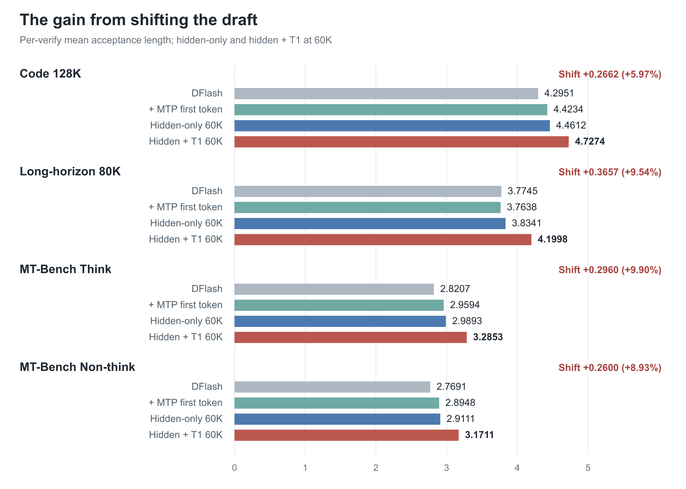
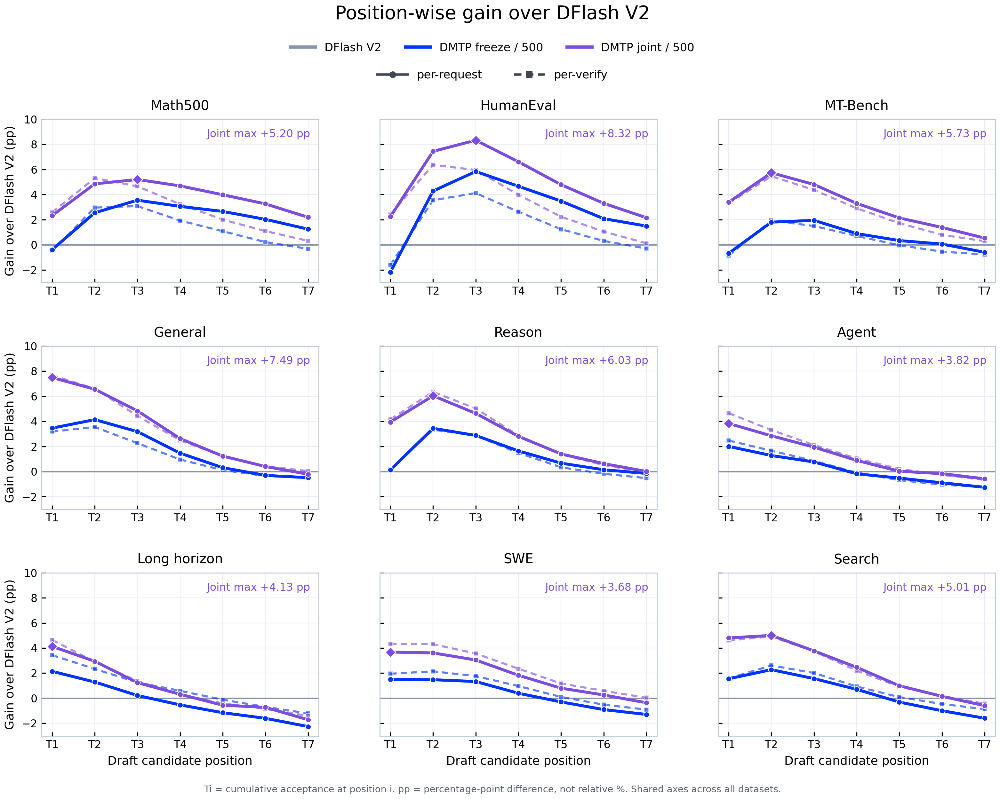

# DMTP V1.5: The Benefits of Shifting the Draft

November 2026 · Technical Blog

<div class="release-resources">
<p class="release-note">Model weights, SGLang inference code, and SpecForge training code are open source.</p>
<nav class="resource-links" aria-label="Open-source weights and code">
<a class="resource-link" href="https://huggingface.co/Piggy12/Qwen3.6-27B-DMTP" target="_blank" rel="noopener noreferrer" title="Qwen3.6-27B DMTP weights on Hugging Face"><span>HF · 3.6-27B</span></a>
<a class="resource-link" href="https://huggingface.co/Piggy12/Qwen3.8-next-120b-dmtp" target="_blank" rel="noopener noreferrer" title="Qwen3.8-Next-120B DMTP weights on Hugging Face"><span>HF · 3.8-Next-120B</span></a>
<a class="resource-link resource-link--primary" href="https://github.com/Sylvan820/sglang-dmtp" target="_blank" rel="noopener noreferrer" title="DMTP inference code"><span>Code</span></a>
<a class="resource-link resource-link--primary" href="https://github.com/sgl-project/sglang/pull/50270" target="_blank" rel="noopener noreferrer" title="SGLang pull request #50270"><span>SGLang PR</span></a>
<a class="resource-link resource-link--primary" href="https://github.com/sgl-project/SpecForge/pull/1067" target="_blank" rel="noopener noreferrer" title="SpecForge pull request #1067"><span>SpecForge PR</span></a>
</nav>
</div>

In [DMTP V1](index.html?lang=en), we focused on DFlash's first-token accuracy and OOD generalization. [Domino](https://arxiv.org/abs/2605.29707), [DSpark](https://arxiv.org/abs/2607.05147), and [DFlash2](https://inco.ai/blog/dflash2/) primarily improve intra-block dependencies and later-position accuracy decay. Strengthening the first token and its generalization beyond draft-training domains remains a complementary, underexplored problem.

Native MTP offers pretrained first-token capabilities, but a multi-step rollout adds sequential latency. **Can we reuse MTP for a stronger first candidate and let DFlash continue in parallel?** DMTP does so through T1 and its hidden state. V1.5 separates these effects, focusing on **the gain from shifting the draft**, even when first-token accuracies are similar. This cooperation complements block-internal improvements, as demonstrated with DFlash and DFlash2.

**Even with similar first-token accuracy, DMTP can benefit: MTP proposes T1, so DFlash starts at T2 and predicts continuation tokens one position closer to its known prefix.**

## 1. Three Sources of Improvement

### First-token pretraining: training and domain matter

MTP does not inherently have higher first-token accuracy than DFlash. The comparison depends on training, data distribution and evaluation domain. A task-trained DFlash can match or outperform MTP in familiar settings.

In our tested Qwen3.5 and Qwen3.6 configurations, MTP had a clear first-token advantage. In our tested Qwen3.8 configuration, DFlash2 approaches MTP's first-token accuracy.

We suspect target training-data patterns contribute to this change. Results also vary across teams; we have observed stronger MTP first-token performance in GLM settings.

The point is not that MTP must always win. **Its first-token predictor has seen extensive pretraining data and may retain stronger out-of-distribution generalization.**

DMTP reuses this capability through T1, then continues with parallel DFlash drafting. This motivates extending it to longer and more complex workloads, rather than guaranteeing gains in every domain.

### Shifting: DMTP's second token is DFlash's first unknown token

Original DFlash predicts T1, T2, T3 and so on from A. DMTP first obtains T1, then asks DFlash for T2 onward. Training uses ground-truth T1; inference uses the actual MTP proposal.

```text
Original DFlash: A known      -> predict T1, T2, T3 ...
DMTP:           A, T1 known  -> predict T2, T3, T4 ...
                                       ^
                              first unknown position
```

DMTP's T2 therefore takes the role of DFlash's first unknown token. Its training accuracy can approach the original draft's T1 accuracy, rather than facing the original second-position task. Later positions can benefit similarly.

**This changes the conditioning of parallel drafting, not just token indices.** Gains still depend on training, T1 quality and inference distribution; the shift alone does not guarantee higher accuracy at every position.

With similar first-token accuracy, replacing T1 alone has less room to help. **Shifting remains an important source of acceptance-length improvement**, and is the focus of V1.5.

### Hidden information: passing the representation that predicted T1

MTP provides both a discrete T1 and the hidden state that predicted it. That representation gives DFlash extra information, separate from first-token accuracy and the known-T1 shift.

Our earlier comparisons found modest gains from hidden information, with relatively small differences between injection methods. We retain a residual interface to preserve the embedding path during continued fine-tuning.

## 2. Ablations: First Token, Hidden State and Shift

To distinguish the first-token advantage from the shift itself, we progressively replace DFlash's first candidate with MTP T1 (**+ MTP first token**), add MTP hidden information (**hidden-only**), then condition drafting on a known T1 to predict T2 onward (**hidden + T1**). The comparison asks whether shifting helps when a stronger first token alone offers little gain.

<figure><a href="v15-shift-ablation.png" target="_blank" rel="noopener"></a></figure>

*Figure 1. Per-verify mean acceptance length as we add MTP T1, MTP hidden information and known-T1 conditioning. Both trained variants use 60K checkpoints.*

| Dataset | First-token increment | Hidden increment | T1 / shift increment | Shift vs. hidden-only |
| --- | ---: | ---: | ---: | ---: |
| Code 128K | +0.1283 | +0.0378 | **+0.2662** | **+5.97%** |
| Long-horizon 80K | −0.0107 | +0.0703 | **+0.3657** | **+9.54%** |
| MT-Bench Think | +0.1387 | +0.0299 | **+0.2960** | **+9.90%** |
| MT-Bench Non-think | +0.1257 | +0.0163 | **+0.2600** | **+8.93%** |

*Increments compare adjacent variants; percentages use hidden-only as the denominator. These are per-verify acceptance lengths, not end-to-end throughput.*

Here, MTP's first-token accuracy is only **1–2 percentage points higher**. Substitution and hidden information give smaller gains, while **shifting adds 5.97%–9.90%** across all four workloads.

With similar first-token accuracy, moving DFlash's continuation back to its first unknown position is an important source of DMTP's gains.

## 3. From scratch and From ckpt

We tried both training from scratch and continuing from a checkpoint. Continuation offers a faster path to reusing an existing Draft.

### From scratch

For Qwen3.6-27B, we freeze the Target and native MTP and train the DMTP Draft from scratch. Weights are available at [Piggy12/Qwen3.6-27B-DMTP](https://huggingface.co/Piggy12/Qwen3.6-27B-DMTP/tree/main).

The baseline is **DFlash2 with the same training configuration**. Both methods enable **token RS**. We compare only DFlash2 and dual-anchor DMTP below, using **per-verify** acceptance length.

| Dataset | DFlash2 · token RS | Dual-anchor DMTP · token RS | Gain |
| --- | ---: | ---: | ---: |
| Code | 3.9621 | **4.6022** | +16.16% |
| Math | 4.2909 | **4.8871** | +13.89% |
| MT-Bench | 4.0044 | **4.1826** | +4.45% |
| Agent | 3.8197 | **4.6871** | **+22.71%** |
| SWE | 2.9273 | **3.9427** | **+34.69%** |
| Long-horizon | 3.1929 | **4.3310** | **+35.64%** |

**The training data contains no Agent data, yet DMTP improves acceptance on Agent, SWE and Long-horizon.** This supports reusing MTP's pretrained capabilities to strengthen DFlash2 drafting without additional Agent-specific training.

These gains measure acceptance length, not task success rates.

### From ckpt

We fine-tune an existing DFlash2 checkpoint on SFT data, adding two anchors and a zero-initialized T1 residual. Target and MTP remain frozen; only the Draft, selector and residual layer are updated.

**A few thousand fine-tuning steps suffice to learn DMTP's known-T1 continuation from T2 onward, without retraining the entire Draft.**

On **Qwen3.8-Next**, we compare DMTP after **7,000 fine-tuning steps** with **open-source DFlash2**. Evaluation uses **128K input, 64K output, temperature = 1, RS enabled, and batch size = 32**. The table reports per-verify mean acceptance length and first-token acceptance rate.

| Dataset | Open-source DFlash2 acceptance length | DMTP7000 acceptance length | DFlash2 first token | DMTP first token |
| --- | ---: | ---: | ---: | ---: |
| General | 2.5339 | **2.7944** | 61.80% | **67.40%** |
| Reason | 2.7902 | **3.2578** | 69.46% | **77.04%** |
| Agent | 3.8963 | **4.2819** | 76.82% | **82.10%** |
| Long-horizon | 3.5280 | **4.0195** | 74.03% | **81.43%** |
| SWE | 4.0989 | **4.4628** | 81.96% | **86.86%** |
| Search | 2.9158 | **3.1454** | 63.23% | **67.62%** |

In a separate experiment, we continue a **CPT (Continued Pre-training)** DFlash2 for **4,000 steps**. Its first-token acceptance already approaches or exceeds MTP on several tasks, yet shifting still improves continuation.

Each cell lists **MTP / DFlash2 CPT / DMTP4000**, with DMTP in bold. Values are **per-verify cumulative acceptance rates (%, excluding bonus)**, not conditional acceptance rates.

| Dataset | T1 | T2 | T3 | T4 |
| --- | ---: | ---: | ---: | ---: |
| General | 74.78 / 75.69 / **75.15** | 55.27 / 54.31 / **57.90** | 41.38 / 39.28 / **43.99** | 31.72 / 29.14 / **34.07** |
| Reason | 75.72 / 75.91 / **76.04** | 56.45 / 52.58 / **58.73** | 42.00 / 35.74 / **43.00** | 31.50 / 24.60 / **30.93** |
| Agent | 86.40 / 86.58 / **85.87** | 74.73 / 73.56 / **75.17** | 65.12 / 63.10 / **65.61** | 57.18 / 55.19 / **57.75** |
| Long-horizon | 83.13 / 83.08 / **82.87** | 70.00 / 66.99 / **71.35** | 59.28 / 54.66 / **60.92** | 50.99 / 45.35 / **51.96** |
| SWE | 86.63 / 88.08 / **86.51** | 74.61 / 74.54 / **76.54** | 64.64 / 62.72 / **66.35** | 56.03 / 53.24 / **57.43** |
| Search | 80.30 / 82.83 / **79.81** | 62.97 / 64.08 / **64.93** | 49.32 / 48.40 / **50.41** | 38.90 / 36.71 / **38.55** |

| Dataset | T5 | T6 | T7 | T8 |
| --- | ---: | ---: | ---: | ---: |
| General | 24.86 / 22.36 / **27.16** | 19.61 / 17.65 / **21.99** | 15.53 / 14.21 / **18.05** | 12.22 / 11.68 / **14.88** |
| Reason | 23.75 / 17.39 / **22.35** | 18.00 / 12.65 / **16.36** | 13.74 / 9.43 / **12.20** | 10.53 / 7.21 / **9.26** |
| Agent | 50.52 / 48.88 / **51.42** | 44.53 / 43.91 / **46.21** | 39.39 / 39.73 / **41.97** | 34.58 / 36.21 / **38.31** |
| Long-horizon | 44.08 / 38.24 / **44.69** | 38.03 / 32.81 / **39.03** | 33.00 / 28.70 / **34.55** | 28.76 / 25.29 / **30.72** |
| SWE | 49.13 / 45.93 / **49.85** | 43.12 / 40.39 / **44.03** | 37.71 / 35.98 / **39.37** | 32.85 / 32.56 / **35.53** |
| Search | 30.69 / 28.27 / **29.67** | 24.50 / 22.17 / **23.36** | 19.57 / 17.76 / **18.80** | 15.57 / 14.45 / **15.25** |

**From T2 onward, DMTP exceeds DFlash2 CPT at every reported position on all six workloads, and exceeds MTP at most positions.** This illustrates the benefit of shifted, known-T1 continuation even when first-token performance is similar.

### Sparse RS

The inference pipeline now supports sparse RS: only top-k logits are stored for every candidate token, including T1, reducing transfer overhead in TP (Tensor Parallelism) communication. We also plan to integrate and test sparse Block Verify.

## 4. Joint Training: Strengthening the First Token on Specialized Tasks

A frozen MTP can limit DMTP when its first-token accuracy trails a domain-trained DFlash. We therefore explore **joint MTP–DFlash SFT**: preserve the shifted continuation task while adapting MTP's first-token prediction to specialized data.

We keep the Target backbone frozen and train MTP's first-token prediction alongside DFlash's continuation, allowing both to adapt to specialized data.

### Joint Loss: Learning the First Token and Continuation

MTP predicts T1; the DFlash base head predicts T2–T8. Both match the frozen Target's full-vocabulary distribution with **LogTV**. The selector additionally uses teacher-to-selector KL within each position's top-16 candidate set.

```text
LogTV(p, q) = -log(max(sum_v min(p(v), q(v)), 1e-6))
L_joint = sum_{i=1..8} w_i * LogTV(p_i, q_i)
        + sum_{i=2..8} v_i * KL(p_i restricted to S_i || s_i)
w_i ∝ exp(-(i-1)/4),  sum_{i=1..8} w_i = 1
v_i ∝ exp(-(i-2)/4),  sum_{i=2..8} v_i = 1
```

Here p is the Target distribution, q the corresponding MTP or DFlash base-head distribution, and s the selector distribution. Both KL distributions are renormalized within candidate set S.

LogTV weights decay across all eight positions. The selector retains its seven-position weighting; no T1 selector loss or extra hard-label CE is added.

**T1 LogTV updates MTP; tail objectives update DFlash, the selector and fusion layer.** The MTP hidden passed to fusion remains detached, so tail gradients do not reach MTP. The Target backbone, shared embedding and LM head remain frozen.

The formula describes one valid block. The implementation aggregates with loss masks and retains existing MoE auxiliary objectives.

<figure><a href="v15-joint-position-gain.png" target="_blank" rel="noopener"></a></figure>

*Figure 2. Cumulative acceptance gains over DFlash V2 (pp). Blue: frozen MTP; purple: joint training. We focus on the per-verify dashed lines; solid lines show per-request statistics.*

**Joint training can restore a first-token advantage.** On Math500, HumanEval and MT-Bench, frozen-MTP T1 trails DFlash V2 slightly. After joint training, the per-verify T1 gain turns positive, with larger gains at several later positions too.

### Terminal Bench: Adapting with RL Traces

We also perform **SFT on collected Terminal Bench RL traces** for terminal and agent workloads, rather than online RL. This separate comparison starts from the same CPT initialization and keeps the Target backbone unchanged.

We compare Draft-only training with frozen MTP against joint MTP–Draft training. Evaluation uses 255 expanded Terminal Bench requests, rejection sampling, concurrency 32 and eight draft candidates per round.

All metrics below are **per-verify**. Acceptance length includes the bonus token; first-token acceptance excludes it. Length gains are relative to the frozen-MTP baseline.

| Training | Acceptance length | First-token acceptance | Length gain |
| --- | ---: | ---: | ---: |
| Draft-only, frozen MTP / 750 steps | 4.3178 | 79.80% | — |
| Joint / 750 steps | 4.4239 | 81.18% | **+2.46%** |
| Joint / 900 steps | **4.4745** | **81.45%** | **+3.63%** |

**At the same 750 steps, joint training adds 1.38 percentage points of first-token acceptance and 2.46% acceptance length.** The 900-step result also includes 150 additional training steps relative to the baseline.

These are inference acceptance statistics, not Terminal Bench task success rates.

**Shifting strengthens continuation; joint training strengthens the specialized first token.** Together, they give DMTP more pronounced acceptance gains on these specialized workloads.

## 5. Future Directions

### First-token Prediction Without Native MTP Pretraining

Future target models may not include an MTP module trained during pretraining. We are exploring **EAGLE + DFlash**: a lightweight EAGLE-style predictor supplies the first token, followed by parallel DFlash continuation.

**Joint CPT of the first-token module and DFlash** could reduce dependence on native pretrained MTP. The goal is a lower additional training budget, without repeating target-scale pretraining.

This may offer a next-generation speculative-decoding paradigm, but its effectiveness, generalization and training cost remain research questions. Key directions include:

- **Explaining the first-token gap.** How much comes from depth, architecture, hidden-state injection, data and training objectives?
- **Reducing serial cost.** How can LM-head projection, token selection and first-token execution become cheaper while preserving sampling correctness?
- **Designing joint losses.** How should first-token, tail, selector and positional objectives be balanced to retain generalization and better align training with acceptance length and throughput?

### Building with the Community

We are collaborating with **multiple teams to bring DMTP into practice**.

Weights and inference code are open source. Architecture, joint training and inference optimization all benefit from shared community maintenance. We welcome reproductions, feedback and contributions across models and workloads.

---

[Previous article: DMTP V1](index.html?lang=en)
