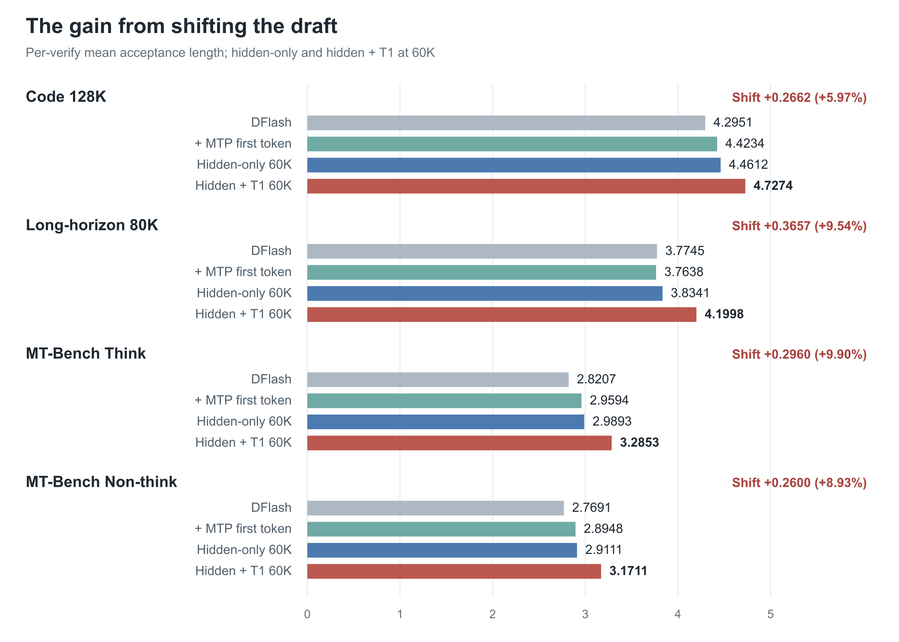
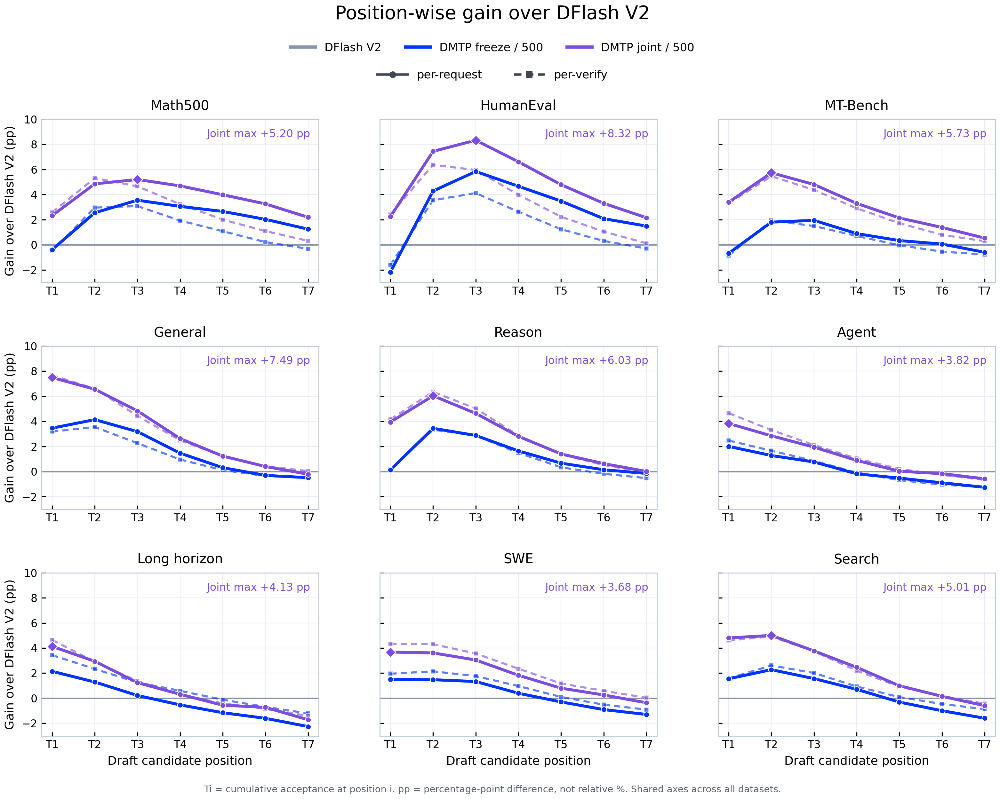

# DMTP V1.5：移位带来的收益

2026 年 11 月 · 技术博客

<div class="release-resources">
<p class="release-note">权重、SGLang 推理代码以及 SpecForge 训练代码已开源。</p>
<nav class="resource-links" aria-label="开源权重与代码">
<a class="resource-link" href="https://huggingface.co/Piggy12/Qwen3.6-27B-DMTP" target="_blank" rel="noopener noreferrer" title="Qwen3.6-27B DMTP weights on Hugging Face"><span>HF · 3.6-27B</span></a>
<a class="resource-link" href="https://huggingface.co/Piggy12/Qwen3.8-next-120b-dmtp" target="_blank" rel="noopener noreferrer" title="Qwen3.8-Next-120B DMTP weights on Hugging Face"><span>HF · 3.8-Next-120B</span></a>
<a class="resource-link resource-link--primary" href="https://github.com/Sylvan820/sglang-dmtp/tree/dmtp-qsa-four-slot-20261113" target="_blank" rel="noopener noreferrer" title="DMTP QSA inference code"><span>Code</span></a>
<a class="resource-link resource-link--primary" href="https://github.com/sgl-project/sglang/pull/50270" target="_blank" rel="noopener noreferrer" title="SGLang pull request #50270"><span>SGLang PR</span></a>
<a class="resource-link resource-link--primary" href="https://github.com/sgl-project/SpecForge/pull/1067" target="_blank" rel="noopener noreferrer" title="SpecForge pull request #1067"><span>SpecForge PR</span></a>
</nav>
</div>

在 [DMTP V1](index.html?lang=zh) 中，我们讨论了 DMTP 相比 DFlash 的三类收益：MTP 的首位预测能力、给定 T1 后并行起草的移位，以及 MTP hidden 提供的额外信息。V1.5 进一步拆开这三件事，尤其是容易被首位优势掩盖的**移位收益**。

**即使 MTP 与 DFlash 的首 token accuracy 接近，DMTP 仍能受益：让 MTP 负责 T1，DFlash 就从 T2 开始，把后续候选的预测距离缩短一个位置。**

## 1. 重新拆解 DMTP 的三类收益

### 预训练首位能力：优势取决于训练与 domain

MTP 的首 token accuracy 并不是天然高于 DFlash。它与 MTP 的训练充分程度、数据分布和评测 domain 强相关；DFlash 经过针对性训练，在熟悉的任务上未必比 MTP 差。

在我们测试的 Qwen3.5、Qwen3.6 配置中，MTP 的首位优势较明显。而在所测 Qwen3.8 配置上，DFlash2 已能接近 MTP 的首位水平。我们怀疑这一变化与主模型训练数据的 pattern 有关。

不同模型团队的情况也不同，我们观察到 GLM 的 MTP 首位能力较强。因此，重点不是“MTP 一定更准”，而是**它的首位预测经历了大量预训练数据，有机会保留更好的分布外泛化能力**。

在 OOD、长文和更复杂的场景中，这种预训练先验可能更稳健。DMTP 通过 MTP 提供的 T1 复用这项能力，再让 DFlash 并行续写。这是向更长、更复杂负载迁移的动机，而不是对所有 domain 的统一保证。

### 移位：DMTP 的第二个 token，是 DFlash 的第一个未知 token

原始 DFlash 从 A 出发，同时预测 T1、T2、T3……。DMTP 则先得到 T1，再让 DFlash 预测 T2、T3……。训练时，T1 使用 ground truth；推理时，T1 来自真实的 MTP 提议。

```text
原始 DFlash：A 已知       → 预测 T1、T2、T3……
DMTP：      A、T1 已知   → 预测 T2、T3、T4……
                           ↑
                      第一个未知位置
```

因此，DMTP 的 T2 承担的是 DFlash“第一个未知 token”的预测任务，其训练 accuracy 可以逼近原始 DFlash 的 T1，而不再承担原始第二位置的预测难度。后续位置也获得类似的移位机会。

**这不是把推理输出整体挪一格，而是改变并行起草的条件：在已知 T1 的基础上预测后面的 token。** 实际提升仍取决于训练、T1 质量和推理分布，不能只凭移位形式保证每一位置都更准。

当 MTP 和 DFlash 首位 accuracy 已经相近时，只更换首位的收益会变小，**移位就成为 DMTP 仍能提升接受长度的重要来源**。这是 V1.5 最想强调的一点。

### Hidden 信息：传递预测 T1 时的表示

除了 T1 这个离散 token，MTP 还提供预测它时的 hidden。DFlash 可以利用这份额外表示续写；它与“更准的首位”和“已知 T1 带来的移位”是不同的收益来源。

此前的接口对照中，加入 hidden 能带来一定接受长度收益，但不同 hidden 利用方式之间的差距相对有限。因此，我们保留残差接口，在传递特征的同时保持原有 embedding 路径，便于已有 DFlash 权重续训。

## 2. 逐级消融：首位、hidden 与移位

我们从 DFlash 逐步加入三项改动：**DFlash + MTP 首位**只替换第一个候选，观察首位收益；**hidden-only**在此基础上加入 MTP hidden；**hidden + T1**再将 T1 作为已知输入，让 DFlash 从 T2 开始预测，观察移位收益。

<figure><a href="v15-shift-ablation.png" target="_blank" rel="noopener"></a></figure>

*图 1：per-verify 平均接受长度。四种方法逐步加入 MTP 首位、MTP hidden 和已知 T1；两种训练变体均使用 60K checkpoint。*

| 数据集 | 仅换首位的增量 | 加 hidden 的增量 | 加 T1 / 移位的增量 | 移位相对 Hidden-only |
| --- | ---: | ---: | ---: | ---: |
| Code 128K | +0.1283 | +0.0378 | **+0.2662** | **+5.97%** |
| Long-horizon 80K | −0.0107 | +0.0703 | **+0.3657** | **+9.54%** |
| MT-Bench Think | +0.1387 | +0.0299 | **+0.2960** | **+9.90%** |
| MT-Bench Non-think | +0.1257 | +0.0163 | **+0.2600** | **+8.93%** |

*增量均对比前一步；最后一列以 hidden-only 为分母。图表采用 per-verify 接受长度，不代表端到端吞吐。*

本组配置中，MTP 首位 accuracy 仅高约 **1～2 个百分点**，首位替换和 hidden 的增量较小；**移位则在四项负载上进一步带来 5.97%～9.90% 的接受长度提升**。这说明，首位能力相近时，让 DFlash 从 T2 开始、重新站到“第一个未知位置”上，是 DMTP 的重要收益来源。

## 3. From scratch 与 From ckpt

我们尝试了从头训练和基于已有 checkpoint 续训两条路线，后者更适合快速复用已有 Draft 的能力。

### From scratch

在 Qwen3.6-27B 上，我们冻结 Target 与 MTP，从头训练 DMTP Draft。权重见 [Piggy12/Qwen3.6-27B-DMTP](https://huggingface.co/Piggy12/Qwen3.6-27B-DMTP/tree/main)。

Baseline 为**相同训练配置的 DFlash2**，两组均开启 **token RS**。下面只比较 DFlash2 与双 anchor DMTP，接受长度采用 **per-verify** 口径。

| 数据集 | DFlash2 · token RS | 双 anchor DMTP · token RS | 提升 |
| --- | ---: | ---: | ---: |
| Code | 3.9621 | **4.6022** | +16.16% |
| Math | 4.2909 | **4.8871** | +13.89% |
| MT-Bench | 4.0044 | **4.1826** | +4.45% |
| Agent | 3.8197 | **4.6871** | **+22.71%** |
| SWE | 2.9273 | **3.9427** | **+34.69%** |
| Long-horizon | 3.1929 | **4.3310** | **+35.64%** |

**训练数据不包含 Agent 数据，但 DMTP 在 Agent、SWE 与 Long-horizon 上仍有明显提升。** 这支持我们复用 MTP 预训练能力的思路：不依赖额外 Agent 专项训练，也能增强 DFlash2 在这些负载上的起草与接受能力；这里的提升指接受长度，不是任务成功率。

### From ckpt

我们从已有 DFlash2 checkpoint 出发，加入双 anchor 和 T1 零初始化残差，在 SFT 数据上微调。Target 与 MTP 冻结，只更新 Draft、selector 和残差层。**不必重训整套 Draft，只需数千步微调，就能学习 DMTP“已知 T1、从 T2 开始预测”的移位续写能力。**

下面从经过 **CPT（Continued Pre-training）** 的 DFlash2 续训 **4,000 步**。起点的首 token 接受率已与 MTP 接近，部分任务甚至更高，后续位置仍能从移位中获益。

每格按 **MTP / DFlash2 CPT / DMTP4000** 排列，粗体标出 DMTP。数值为 **per-verify 逐位置累计接受率（%，不含 bonus）**，不是条件接受率。

| 数据集 | T1 | T2 | T3 | T4 |
| --- | ---: | ---: | ---: | ---: |
| General | 74.78 / 75.69 / **75.15** | 55.27 / 54.31 / **57.90** | 41.38 / 39.28 / **43.99** | 31.72 / 29.14 / **34.07** |
| Reason | 75.72 / 75.91 / **76.04** | 56.45 / 52.58 / **58.73** | 42.00 / 35.74 / **43.00** | 31.50 / 24.60 / **30.93** |
| Agent | 86.40 / 86.58 / **85.87** | 74.73 / 73.56 / **75.17** | 65.12 / 63.10 / **65.61** | 57.18 / 55.19 / **57.75** |
| Long-horizon | 83.13 / 83.08 / **82.87** | 70.00 / 66.99 / **71.35** | 59.28 / 54.66 / **60.92** | 50.99 / 45.35 / **51.96** |
| SWE | 86.63 / 88.08 / **86.51** | 74.61 / 74.54 / **76.54** | 64.64 / 62.72 / **66.35** | 56.03 / 53.24 / **57.43** |
| Search | 80.30 / 82.83 / **79.81** | 62.97 / 64.08 / **64.93** | 49.32 / 48.40 / **50.41** | 38.90 / 36.71 / **38.55** |

| 数据集 | T5 | T6 | T7 | T8 |
| --- | ---: | ---: | ---: | ---: |
| General | 24.86 / 22.36 / **27.16** | 19.61 / 17.65 / **21.99** | 15.53 / 14.21 / **18.05** | 12.22 / 11.68 / **14.88** |
| Reason | 23.75 / 17.39 / **22.35** | 18.00 / 12.65 / **16.36** | 13.74 / 9.43 / **12.20** | 10.53 / 7.21 / **9.26** |
| Agent | 50.52 / 48.88 / **51.42** | 44.53 / 43.91 / **46.21** | 39.39 / 39.73 / **41.97** | 34.58 / 36.21 / **38.31** |
| Long-horizon | 44.08 / 38.24 / **44.69** | 38.03 / 32.81 / **39.03** | 33.00 / 28.70 / **34.55** | 28.76 / 25.29 / **30.72** |
| SWE | 49.13 / 45.93 / **49.85** | 43.12 / 40.39 / **44.03** | 37.71 / 35.98 / **39.37** | 32.85 / 32.56 / **35.53** |
| Search | 30.69 / 28.27 / **29.67** | 24.50 / 22.17 / **23.36** | 19.57 / 17.76 / **18.80** | 15.57 / 14.45 / **15.25** |

**从 T2 开始，DMTP 在六项负载的所有后续位置上都高于 DFlash2 CPT，多数位置也高于 MTP。** 这体现了移位的收益：即使首位已经相近，让 Draft 以已知 T1 开始续写，仍能改善后续起草。

## 4. 联合训练：进一步提升专项任务的首位能力

如果原生 MTP 在某个 domain 的首位 accuracy 不如专门训练的 DFlash，只依靠冻结 MTP 就会限制 DMTP 的收益。为此，我们进一步尝试 **MTP 与 DFlash 联合 SFT**：保留移位收益，同时让 MTP 的首位预测也适应专项数据。

我们保持 Target 主干冻结，同时训练 MTP 的首位预测与 DFlash 的后续起草，让两者共同适应专项数据。

### 联合 Loss：首位与续写分别学习

T1 由 MTP 预测，T2～T8 由 DFlash 基础头预测，两者都对齐冻结 Target 的全词表分布，使用 **LogTV**；selector 另在各位置的 top-16 候选集合内计算 teacher 到 selector 的 KL：

```text
LogTV(p, q) = -log(max(sum_v min(p(v), q(v)), 1e-6))
L_joint = sum_{i=1..8} w_i * LogTV(p_i, q_i)
        + sum_{i=2..8} v_i * KL(p_i restricted to S_i || s_i)
w_i ∝ exp(-(i-1)/4),  sum_{i=1..8} w_i = 1
v_i ∝ exp(-(i-2)/4),  sum_{i=2..8} v_i = 1
```

其中 p 为 Target 分布，q 为对应位置的 MTP 或 DFlash 基础头分布，s 为 selector 分布；KL 两侧都在候选集 S 内重新归一化。首位与尾部 LogTV 使用统一的八位置衰减，selector 保留原七位置权重，不额外给 T1 加 selector loss 或 hard-label CE。

**MTP 由 T1 LogTV 更新，DFlash、selector 与融合层由尾部目标更新。** 供融合使用的 MTP hidden 仍然 detach，尾部梯度不回传 MTP；Target 主干、共享 embedding 和 LM head 冻结。上式表示单个有效 block 的目标，实际还按 loss mask 汇总，并保留原有 MoE 辅助项。

<figure><a href="v15-joint-position-gain.png" target="_blank" rel="noopener"></a></figure>

*图 2：相对 DFlash V2 的逐位置累计接受率增益（pp）。蓝色为冻结 MTP，紫色为联合训练；本文关注 per-verify 虚线，原图实线为 per-request。*

**联合训练后，首位优势可以重新建立。** 在 Math500、HumanEval 和 MT-Bench 上，冻结 MTP 时 T1 略低于 DFlash V2；联合训练后，per-verify 的 T1 增益转为正值，后续多个位置也得到更明显的改善。

### Terminal Bench：RL trace 专项适配

我们还用已采集的 **Terminal Bench RL trace 做 SFT**，进一步适配终端与 agent 场景，而不是在线运行 RL。下面是另一组同一 CPT 初始化、Target 主干不变的对照：冻结 MTP，仅训练 Draft，与同时更新 MTP 的联合训练比较。

评测使用 Terminal Bench 的 255 条展开请求，RS 开启、并发 32，每轮起草 8 个候选。表中均为 **per-verify**：接受长度含 bonus，首 token 接受率不含 bonus。

| 训练方式 | 接受长度 | 首 token 接受率 | 接受长度提升 |
| --- | ---: | ---: | ---: |
| 单独训练 750 步，冻结 MTP | 4.3178 | 79.80% | — |
| 联合训练 750 步 | 4.4239 | 81.18% | **+2.46%** |
| 联合训练 900 步 | **4.4745** | **81.45%** | **+3.63%** |

**同为 750 步，联合训练将首位接受率提高 1.38 个百分点，接受长度提高 2.46%。** 继续至 900 步还有提升，但相对冻结组的比较包含额外 150 步训练；这里衡量的是推理接受率，不是 Terminal Bench 任务成功率。

**移位提高后续起草能力，联合训练则补强专项任务的首位能力。** 两者结合，让 DMTP 在这些专项场景中获得更明显的接受率收益。

## 5. Future Directions

### 不依赖原生 MTP 的首位预测

未来的主模型未必都会在预训练阶段配套训练 MTP。我们也在探索 **EAGLE + DFlash**：由 EAGLE 式轻量预测器承担首位，再交给 DFlash 并行续写，并通过 **CPT 联合训练首位模块与 DFlash**，尝试替代对原生预训练 MTP 的依赖。

我们希望用较低的追加训练成本获得这套协作能力，而不必重复主模型级别的大规模预训练。它可能成为下一代投机解码的一种范式，但效果、泛化性与训练成本仍需要实验验证。

围绕这一方向，还有几个关键问题：

- **首位差距来自哪里？** MTP 与 DFlash 的首 token accuracy 差异，分别有多少来自层数、结构、hidden 注入方式，以及训练数据与目标？
- **如何减少串行开销？** 尤其是 LM head 的词表投影、选词和首位模块执行，能否在保持采样正确性的前提下进一步优化？
- **如何设计联合 Loss？** 如何平衡首位与尾部目标、selector 和位置权重，在 domain 适配时保留预训练泛化能力，并让训练目标更贴近实际接受长度与吞吐？

### 一起推进落地

我们正在与**多个团队合作推进 DMTP 落地**。权重与推理代码均已开源；从架构设计、联合训练到推理优化，都需要社区共同探索和维护。欢迎复现、反馈，以及来自不同模型和负载的贡献。

---

[上一篇：DMTP V1](index.html?lang=zh)
