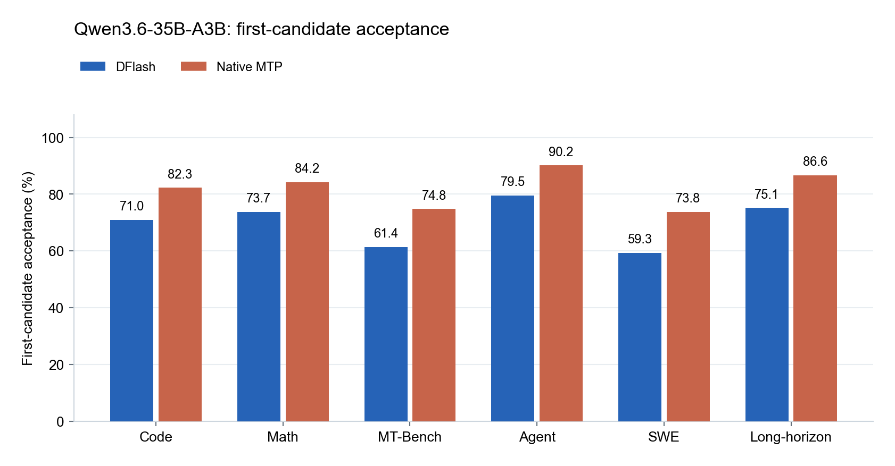
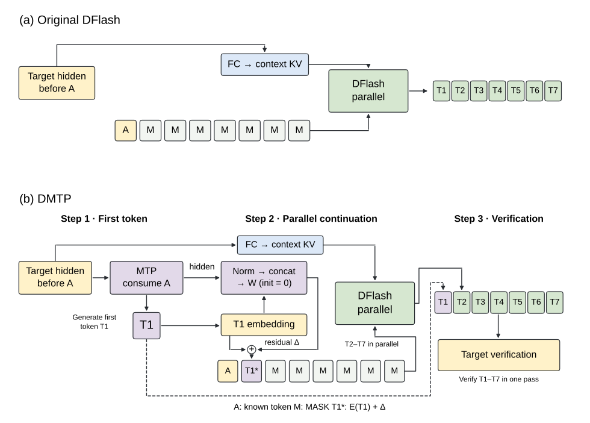
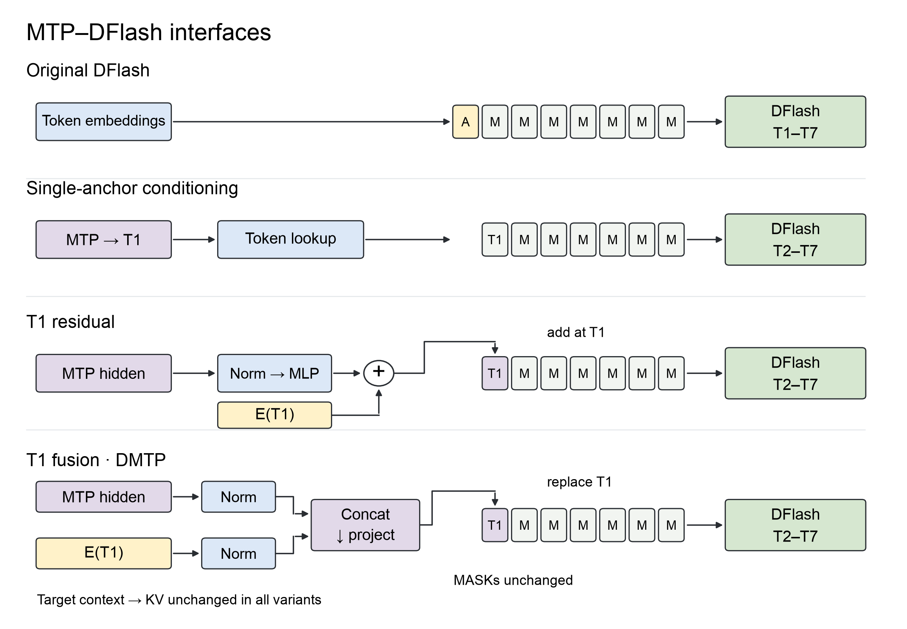
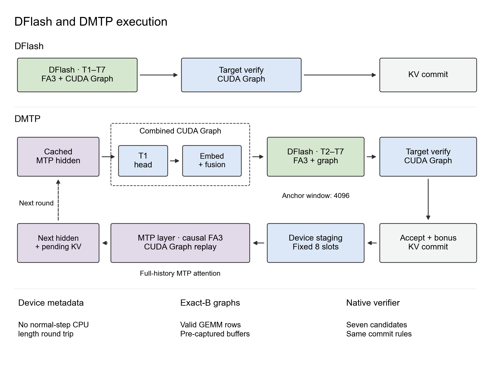
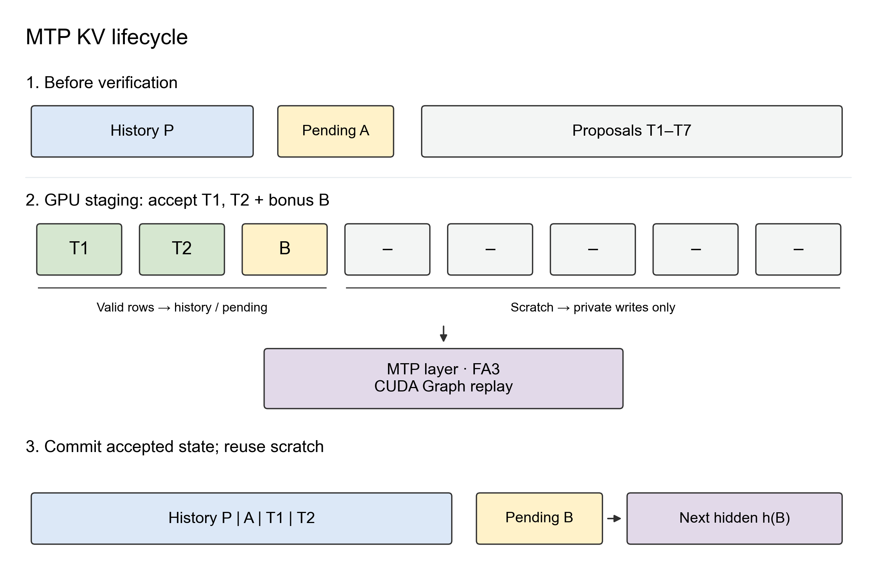
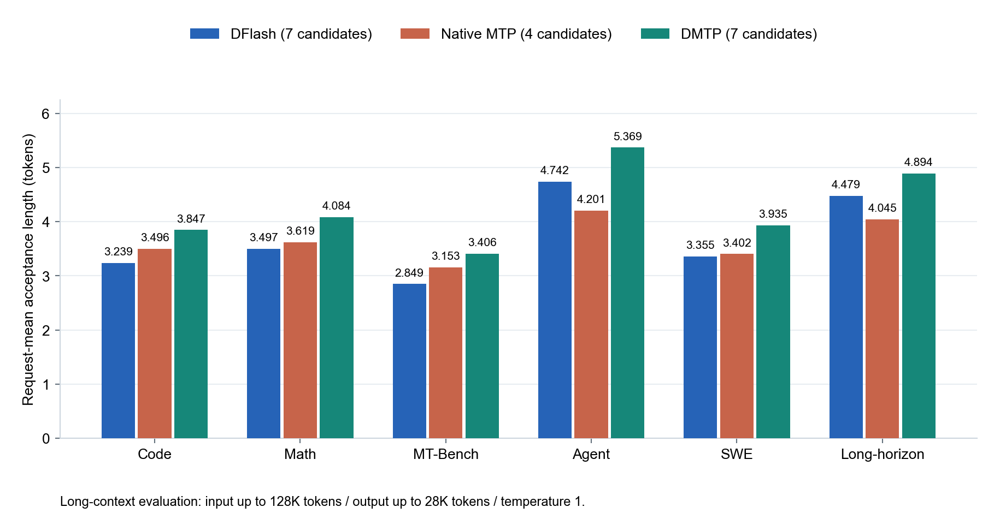
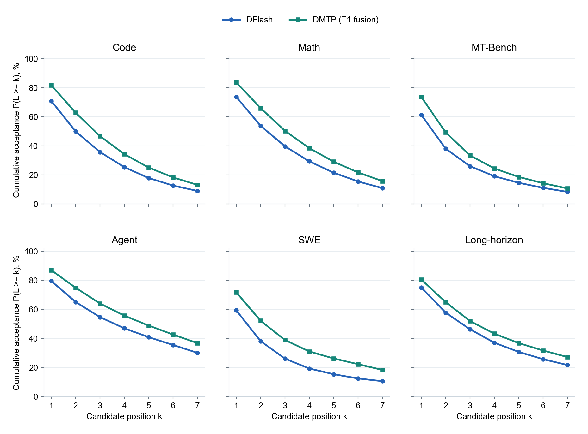
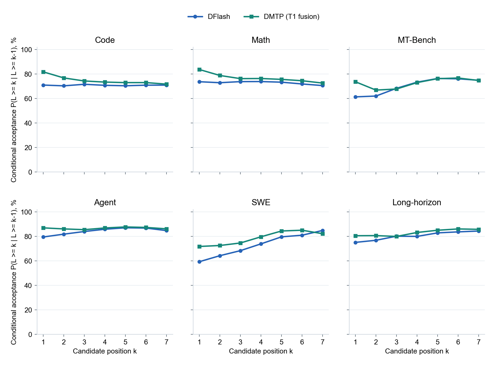
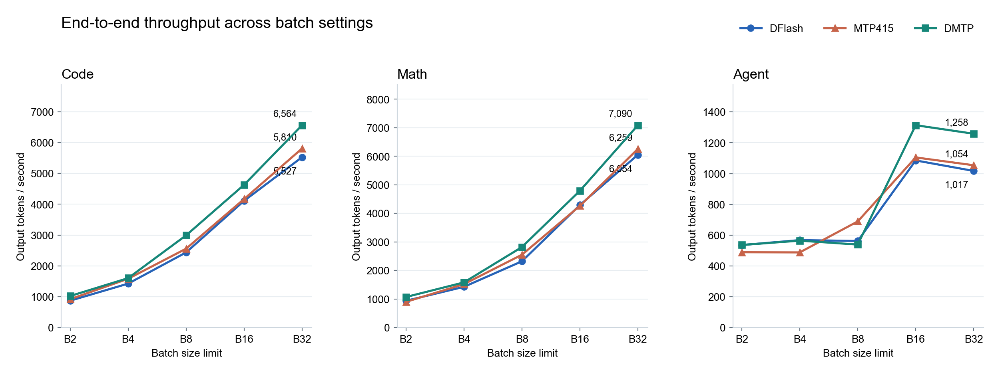
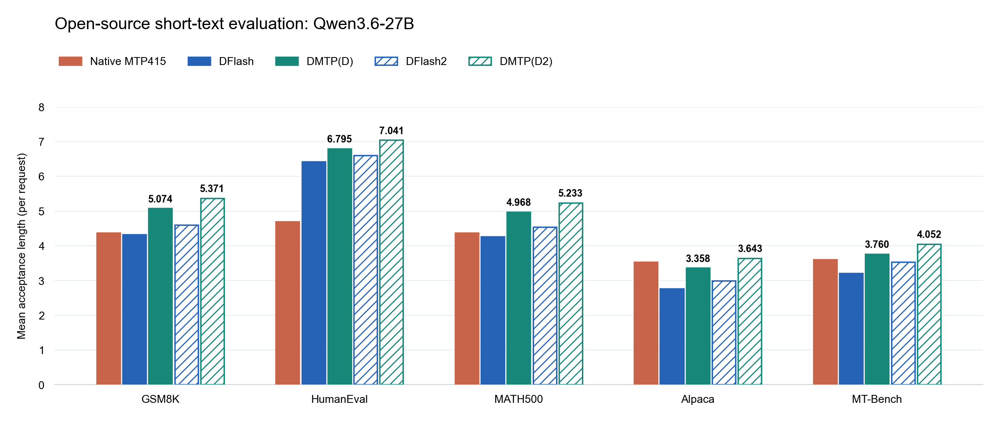

# DMTP: A Better First Token for Block Drafting via MTP

**Piggy Shen · October 2026 · Technical Blog**

> **Update · November 9, 2026**
>
> We find that **zero-initialized residual injection performs comparably to direct fusion and is better suited to continued fine-tuning from existing DFlash weights**. We therefore adopt **two anchors with a zero-initialized residual at the first candidate's embedding slot**, retaining the original embedding while learning to incorporate MTP's predictive features.

> **Update · November 4, 2026**
>
> We find that single- and dual-anchor layouts perform similarly when trained from scratch, but **the dual-anchor layout performs better when fine-tuning from existing DFlash weights**. It also achieves **higher end-to-end throughput at comparable acceptance lengths**. We will therefore adopt the dual-anchor layout for subsequent DMTP models and continue sharing updated results. The experimental results reported here remain unchanged.

Speculative decoding is an important component of LLM inference infrastructure. [DFlash](https://z-lab.ai/projects/dflash/) demonstrates the potential of parallel candidate prediction, while DeepSeek has deployed [DSpark](https://arxiv.org/abs/2607.05147) in production and reported gains over MTP. Yet DFlash does not consistently outperform MTP on models with well-trained native MTP modules, such as GLM and Qwen, or on some conversation workloads. We focus on reusing MTP's first-token prediction capability.

Our evaluations and discussions with [Domino](https://arxiv.org/abs/2605.29707) author Jianuo Huang highlight complementary strengths: native MTP has higher first-token acceptance, particularly on workloads outside the training distribution, while DFlash generates a longer continuation in parallel. This motivates combining pretrained first-token prediction with parallel drafting.

Several approaches address the decline in acceptance at later positions within a DFlash-style block. **We focus on a different question: can we improve the first draft token itself?** Under prefix verification, rejecting that first candidate prevents the rest of the block from being committed. DMTP starts with a pretrained MTP prediction, then passes its hidden representation to DFlash for the continuation.

We introduce **DMTP**: pretrained MTP proposes the first candidate token in each drafting round (**T1**), and DFlash predicts the remaining six candidates (**T2–T7**) in parallel. Our main method uses **two anchors and a zero-initialized residual**: retain the emitted token A and first candidate T1, normalize and concatenate T1's embedding with the MTP hidden state that predicted it, and project the pair into a residual added only to T1's embedding.

> **The key idea:** let MTP start the block and DFlash continue it in parallel. The two models share both a concrete candidate and a predictive representation, while retaining their original backbones.

## The Key Observations

- **Reuse MTP's pretrained first-token capability.** We use MTP for the first candidate and DFlash for the next six parallel proposals. Across six workloads, DMTP improves first-token acceptance over DFlash by **5.43–12.46 percentage points**, or **7.23%–21.00% relatively**.
- **Pass MTP's pretrained capability to DFlash through hidden states.** We use MTP not only to generate T1, but also to fuse the hidden state that predicted it with its token embedding. DFlash can then use both the concrete candidate and features learned during MTP pretraining to predict the continuation in parallel.
- **The gains extend across long- and short-text tasks.** On long-text tasks with Qwen3.6-35B-A3B, DMTP improves acceptance length by **9.25%–19.56%** and B32 end-to-end throughput by **17.10%–23.75%**, relative to DFlash. On short-text tasks using public Qwen3.6-27B weights and OpenPerfectBlend, DMTP(DFLASH) improves acceptance length by **5.78%–21.55%** over DFlash, while DMTP(DFlash2) improves it by **6.54%–21.83%** over DFlash2, covering math, code, and chat.
- **DMTP complements optimizations within MTP and DFlash.** We change how the two models cooperate; stronger predictors, training methods, candidate-selection strategies, and inference kernels can all be combined with this framework.

## 1. First-Token Acceptance and Parallel Drafting

Figure 1 compares **DFlash and native MTP** using the same target model. DFlash is trained on a mixture of tasks with 32K sequences; MTP uses the pretrained weights bundled with the same target. First-token acceptance is the fraction of rounds in which the target accepts the first proposed candidate.

Both arms use the same Qwen3.6-35B-A3B target and input set across Code, Math, MT-Bench, Agent, SWE and Long-horizon. **DMTP itself uses MTP for T1 and DFlash for six parallel continuation candidates.**



*Figure 1. First-token acceptance across six workloads on Qwen3.6-35B-A3B at a generation temperature of 1.*

On Code, first-position acceptance is 71.00% for DFlash and 82.32% for MTP.


**We see extensive pretraining as an important source of MTP's first-token advantage.** Native MTP learns alongside the target from much more data than our separately trained DFlash draft. That gives us a reason to preserve its first-token predictor rather than train a replacement.

## 2. DMTP: MTP Starts, DFlash Continues

The division of labor is straightforward:

```text
MTP:     propose T1
DFlash:  condition on T1 and propose T2–T7 in one forward pass
Target:  verify seven candidates and commit the accepted prefix plus correction/bonus
```



*Figure 2. MTP proposes T1 and provides the hidden state that predicted it. We retain A and add a residual only to T1's embedding; DFlash predicts the next six candidates in parallel. A and MASK slots receive no direct residual, and the target-context pathway stays unchanged.*

We chose this division of labor for three reasons.

**Preserve first-token prediction.** We freeze native MTP to retain its pretrained first-step capability and train the parallel continuation separately.

**Shorten the prediction distance.** Given T1, T2 becomes the first unknown token after the new anchor, from which DFlash predicts the continuation in parallel.

**Transfer pretrained features.** Alongside T1, we pass the MTP hidden that predicted it so DFlash can use those features to predict subsequent tokens.

### Single-Step MTP Drafting

We use MTP only for T1 to control serial drafting cost. Additional MTP candidates require successive forward passes and token selection, whereas DFlash predicts the remaining six in one parallel pass.

## 3. MTP Hidden-State Integration and Ablations

We use **two anchors with a zero-initialized residual at T1's embedding slot**, incorporating MTP features while preserving the original token embedding.

Let \(A = x_a\) be the token already emitted by Target but not yet processed by it. Available target-context features end at \(x_{a-1}\). MTP reads A and the preceding target hidden state to propose \(T_1 = x_{a+1}\). We use **the MTP hidden state that predicts T1**, not one obtained after consuming T1.

$$
\Delta = W\left[\operatorname{RMS}_e(\mathbf e_{T_1});\operatorname{RMS}_m(\operatorname{stopgrad}(\mathbf h_{\mathrm{MTP}}))\right],\qquad W_{\mathrm{init}}=0.
$$

$$
\widetilde{\mathbf e}_{T_1}=\mathbf e_{T_1}+\Delta.
$$

DFlash receives:

```text
[E(A), E(T1) + Δ, E(MASK), …, E(MASK)]
```

### A Residual at the First Candidate Only

Each feature stream has its own RMSNorm. We concatenate the normalized features and project back to the embedding dimension. **W is initialized to zero**, so Δ = 0 initially and T1 retains its original E(T1). The residual branch gradually learns to incorporate MTP features during continued fine-tuning.

**Neither A nor the six MASK slots receive a direct residual, and no extra hidden-state slot is inserted.** Later positions attend to the enhanced T1 and are influenced indirectly. The original target-context projection and key/value cache pathway remain unchanged; MTP KV is not appended.

### Two Anchors and Training Boundaries

We retain both A and T1 before the MASK positions, giving eight input slots. A has already been emitted and is not a new proposal. Each round still proposes seven candidates: T1 from MTP and T2–T7 from DFlash in parallel.

**MTP is frozen and its hidden state is detached; we train DFlash, the selector, and the residual fusion layer.** T1 is a known input, while the six MASK positions predict the continuation.

### Ablation Design

- **Original DFlash:** single-anchor external baseline with `[A,MASK×7]`; DFlash proposes all seven candidates.
- **Candidate-conditioned single-anchor drafting:** `[T1,MASK×6]`, without additional MTP state injection; original target context remains available.
- **Hidden-state residual at the first candidate:** project MTP hidden through a low-rank network and add the residual only to the T1 embedding; all six mask inputs stay unchanged.
- **MTP-style token and hidden-state fusion (main method):** independently normalize and concatenate MTP hidden and E(T1), then project to replace only the T1 embedding.

Supplementary controls are a hidden-state residual at six mask positions, target and MTP context fusion, and MTP-only context. Context fusion concatenates five target feature streams and aligned MTP features, then projects 6H→H. These representation-interface comparisons all use T1 as their only anchor.



*Figure 3b. Only the four main-table methods: original DFlash, candidate-conditioned single-anchor drafting, a hidden-state residual at the first candidate, and MTP-style token and hidden-state fusion. All retain the original target-context pathway and the same seven-candidate budget. The final two compare additive residual injection with replacement-style fusion at the first candidate input.*

### Inference Ablation: Code Acceptance Length

We compare representation interfaces on the same eight code-task inputs, holding the models, candidate count, and generation settings fixed.

| Method | Representation interface | Code length | vs candidate conditioning |
| --- | --- | --- | --- |
| Original DFlash | Single anchor; seven proposals | 3.360 | -10.89% |
| Candidate-conditioned single-anchor drafting | Condition on the proposed token without extra state injection | 3.770 | +0.00% |
| Hidden-state residual at the first candidate | Add a residual only at the first candidate input | 3.864 | +2.48% |
| MTP-style token and hidden-state fusion (two anchors) | Original A plus fused T1: [A,T1,MASK×6] | 3.951 | +4.80% |
| **MTP-style token and hidden-state fusion (main method)** | **Replace only the first candidate input representation** | 3.963 | +5.12% |

**Two anchors reach an acceptance length of 3.951, essentially matching the single-anchor main method at 3.963.** We therefore choose one anchor, preserving DFlash's original anchor-plus-MASK structure with fewer interface changes.

**Adding MTP hidden raises acceptance length from 3.770 to 3.963 (+5.12%).** Token and hidden-state fusion performs best in this Code ablation, so we choose it as our main method.

*Acceptance lengths are averaged over eight Code requests and include target correction/bonus tokens. The main table uses a common inference implementation; the supplementary six-mask residual uses a separate implementation as an auxiliary comparison.*

<details>
<summary>Supplement: other uses of MTP hidden</summary>

| Method | Representation interface | Code length | vs candidate conditioning |
| --- | --- | --- | --- |
| Hidden-state residual at six mask positions | Add an MTP hidden-state residual to six mask inputs | 3.842 | +1.92% |
| Target and MTP context fusion | Concatenate and project target and MTP features | 3.714 | -1.49% |
| MTP-only context | Supply context from position-aligned MTP features | 3.565 | -5.43% |

</details>

### Compatibility with Existing Drafting Methods

We retain DFlash's backbone, output head, and target-context interface. With a compatible configuration, we can continue fine-tuning existing DFlash weights, add the T1 fusion module, and supervise the six continuation positions using `[T1,MASK×6]`. Target and MTP remain frozen.

This interface is orthogonal to optimizations within MTP or DFlash and can incorporate stronger predictors, training methods, path selectors, and inference kernels.

### Why Preserve Pretrained MTP?

We also tried repurposing MTP layers for DFlash-style parallel prediction, but saw first-position performance affected and limited convergence gains. We therefore chose to freeze pretrained MTP and train parallel continuation around its T1 proposal.

## 4. Training DMTP

We use Qwen3.6-35B-A3B with 32K training contexts and approximately 250K records, predominantly from Agent and Long-horizon scenarios. MT-Bench evaluates generalization beyond the training distribution.

We train DFlash and DMTP with the same data, training hyperparameters, and training budget. DMTP adds native MTP's first-token prediction and its predicting hidden state, together with a trainable T1 fusion module.

Training follows three steps:

1. **Extract frozen features.** Target processes the training sequence. At each block boundary, MTP consumes A and the preceding target hidden to obtain the representation for predicting T1. DFlash context uses only target features before A.
2. **Build the draft input.** Use `[T1,MASK×6]` with the dataset's T1. Independently normalize E(T1) and its predicting MTP hidden, concatenate, and project to replace the T1 embedding. All six MASK embeddings remain unchanged.
3. **Optimize the continuation.** DFlash learns the remaining six candidates with the original position-decayed cross-entropy loss. The target model and MTP stay frozen; only DFlash and the first-candidate fusion module are updated. The known first-candidate input slot receives no draft prediction loss.

We use <mark>the first candidate token from the training data</mark> during training and the MTP-generated candidate during inference. Hidden-state timing stays consistent: both use the MTP representation that predicts the first candidate, not the hidden state obtained after consuming it.

## 5. Inference: MTP First, DFlash Second

Each generation round follows the order in Figure 2:

1. **MTP proposes T1.** Read the available target hidden and consume pending token A. Keep both the selected T1 and the MTP hidden that predicted it.
2. **DFlash predicts T2–T7.** Form `[T1,MASK×6]`, fuse E(T1) with its predicting MTP hidden, replace only the T1 embedding, and run one parallel DFlash forward.
3. **The target model verifies the block.** Verify all seven candidates together, commit the accepted prefix and correction or bonus token, then advance to the next round. A bonus token is the extra token generated by the target when all draft candidates are accepted.

**We use target-only verification throughout these experiments.** We check candidates token by token against Target samples and accept the consecutive matching prefix. We have not yet integrated rejection sampling or block verify; we plan to compare their effects on acceptance length and throughput.

The runtime keeps MTP and DFlash state separate, commits only accepted history, and rolls back rejected candidates.

The additional computation consists of an MTP forward, its vocabulary output layer (LM head), two normalizations, and a first-candidate fusion projection. The target-context pathway remains unchanged; DFlash uses seven input slots: the first candidate and six masks.

We next focus on state updates, execution scheduling, and CUDA Graph coverage to reduce the handoff cost between MTP and DFlash.

## 6. Inference Implementation and Systems Optimizations

We retain the seven-candidate budget and Target's verification rules, and focus our systems changes on MTP state advancement and T1 preparation.

### 6.1 Separating Prediction from State Advancement



*The dashed frame groups the T1 head, embedding, and fusion in one CUDA Graph; the dashed arrow connects adjacent rounds.*

Prefill initializes all three models' states. Each steady-state round selects T1 from the cached MTP hidden, then runs embedding, fusion, and the DFlash forward.

After Target verification, we advance MTP state using the accepted prefix, correction/bonus token, and corresponding Target hidden states. We cache the next prediction representation so the following round starts directly at the T1 head.

### 6.2 Attention: One Backend, Different Visibility Rules

We keep DFlash's existing FlashAttention-3 and CUDA Graph support and use FlashAttention-3 for the added MTP path as well. The two paths need different visibility rules: MTP reads full history causally, while DFlash reads the last 4096 positions relative to the anchor and its seven-slot block with the visibility used in training.

Temporary DFlash page tables express this visibility without moving persistent key/value caches, changing rotary positional encoding (RoPE) positions, or replacing the anchor-relative window with a query-relative one. The MTP path retains the native FlashAttention-3 operator and prepares fixed-eight-slot metadata on device, avoiding CPU length transfers on normal steps.

### 6.3 Key/Value Cache Lifetime: History, Pending Tokens, and Temporary Storage



*MTP state advancement and commit, illustrated with T1 and T2 accepted and bonus B produced.*

We maintain a separate key/value cache for MTP, with an additional pending-token slot, because the two models advance at different times: MTP may have processed the current anchor while the target has not. After verification, we update their boundaries separately and commit only the states that belong in history.

We reserve eight MTP advancement slots per request so different acceptance lengths can reuse the same graphs. Valid rows enter history or the next pending-token slot; extra rows go to private temporary storage (scratch in the figure). The valid-row count determines what we commit and which hidden state predicts the next first candidate. Temporary outputs do not enter subsequent predictions.

### 6.4 Graph Execution: Preparation and Submission

We pre-capture CUDA Graphs for exact request counts so the fusion matrix multiplication computes only the active rows. During decoding, we prepare data on the device, update fixed buffers, and replay the graph.

We then combine first-candidate vocabulary projection, candidate writing, target-model embedding lookup, and fusion into one graph submission to reduce host scheduling. We merge submissions without changing operator dependencies, precision, highest-probability token selection, or tensor-parallel communication.

| Component | Adaptation or optimization | Cost reduced |
| --- | --- | --- |
| MTP advancement | Device-side fixed eight slots, private KV, graph replay | Normal-step CPU length transfers, pack/expand, repeated scheduling |
| DFlash attention | Temporary FlashAttention-3 pages for anchor window and block visibility | Rebuilding or moving persistent key/value caches for the window |
| First-candidate preparation | Combined vocabulary projection→candidate write→embedding→fusion graph | Multiple host graph submissions and handoffs |
| Accepted-state commit | Valid rows select history, pending-token, and temporary writes and the predictor hidden state | Dynamic-length layout conversion |

### 6.5 Cost Structure After Optimization

After device-side preparation, fixed layouts, and combined graph execution, the main added computation is **one MTP decoder block and the vocabulary output layer that selects the first candidate**. The block includes full-history causal attention, projections, normalization, a feed-forward network, and tensor-parallel communication, so its cost varies with context length.

**The vocabulary output layer is a priority for further optimization.** Even for a single candidate, it reads the large vocabulary matrix and computes scores for every token in the vocabulary.

We plan to explore [EAGLE-4's Efficient LM Head](https://github.com/eagle-hq/EAGLE-4/blob/main/docs/architecture.md), using a low-rank head to shortlist candidates before exact rescoring, as well as drafting-side head quantization to reduce weight traffic and projection cost. Target verification stays unchanged; we will evaluate both acceptance length and throughput.

#### Measured Single-Anchor Overhead

We compare single-anchor T1 fusion at step 1000 with native DFlash at step 3634 on the same four GPUs and Target. Code and SWE each use eight identical inputs, actual batch size eight, and CUDA Graphs. We generate exactly 512 tokens with EOS ignored and exclude the first 16 warmup rounds.

| Stage (ms/round) | Code: DFlash | Code: single anchor | SWE: DFlash | SWE: single anchor |
| --- | ---: | ---: | ---: | ---: |
| DFlash graph replay | 0.386 | 0.388 | 0.442 | 0.427 |
| Additional MTP graph replay | — | 0.214 | — | 0.283 |
| Additional T1 selection, embedding, and fusion | — | 0.290 | — | 0.274 |
| **Whole round, including preparation and verification** | **8.915** | **9.318** | **9.645** | **10.195** |

DFlash replay time is essentially unchanged; the added stages are mainly MTP and T1 preparation. The whole-round interval increases by **0.403 ms on Code** and **0.550 ms on SWE**.

## 7. Main-Method Evaluation Across Six Workloads

Our evaluation focuses on **long-context agent workloads**, with additional coverage of Code, Math, and MT-Bench, comparing DMTP against DFlash and native MTP. The first three workloads (Code, Math, MT-Bench) primarily have **short inputs and long outputs**; the latter three (Agent, SWE, Long-horizon) primarily have **long inputs and short outputs**. MT-Bench evaluates performance outside the training distribution.

Inputs are capped at **128K tokens** and outputs at **28K tokens**. All methods use the same inputs at a generation temperature of 1.

| Workload | DFlash length | Native MTP length* | DMTP length | DMTP vs DFlash |
| --- | --- | --- | --- | --- |
| Code | 3.239 | 3.496 | 3.847 | +18.78% |
| Math | 3.497 | 3.619 | 4.084 | +16.78% |
| MT-Bench | 2.849 | 3.153 | 3.406 | +19.56% |
| Agent | 4.742 | 4.201 | 5.369 | +13.22% |
| SWE | 3.355 | 3.402 | 3.935 | +17.29% |
| Long-horizon | 4.479 | 4.045 | 4.894 | +9.25% |

*Native MTP proposes four candidates; DFlash and DMTP each propose seven.*

*Mean acceptance length includes the target correction or bonus token.*



*Figure 5. DMTP improves mean acceptance length by 9.25%–19.56% over DFlash across six workloads.*

### Position-Wise Acceptance

Figure 6 shows cumulative acceptance from T1 through T7.



*Figure 6. Cumulative acceptance P(L≥k): the fraction of verification rounds accepting the first k draft candidates, excluding correction/bonus tokens. Evaluation settings are unchanged.*

**First-token acceptance improves by 5.43–12.46 percentage points over DFlash, a relative gain of 7.23%–21.00%.** Code increases from 71.00% to 81.81%, Math from 73.73% to 83.72%, and SWE from 59.33% to 71.79%. These gains reflect DMTP's reuse of native MTP's pretrained first-token prediction rather than relearning that capability in DFlash.

DMTP also maintains higher cumulative acceptance at T2–T7: a more reliable first proposal, together with MTP hidden states conditioning parallel continuation, improves acceptance throughout the candidate block.

<details>
<summary>Conditional acceptance: accepting candidate k given that the first k−1 were accepted</summary>



| Workload / model | Verify rounds | T1 | T2 | T3 | T4 | T5 | T6 | T7 |
| --- | --- | --- | --- | --- | --- | --- | --- | --- |
| Code / DFlash | 523201 | 71.00% | 70.38% | 71.64% | 70.79% | 70.43% | 70.91% | 70.97% |
| Code / DMTP (T1 fusion) | 434780 | 81.81% | 76.83% | 74.34% | 73.43% | 73.00% | 73.02% | 71.76% |
| Math / DFlash | 473538 | 73.73% | 72.93% | 73.82% | 73.87% | 73.36% | 71.90% | 70.59% |
| Math / DMTP (T1 fusion) | 404689 | 83.72% | 78.84% | 76.25% | 76.36% | 75.64% | 74.54% | 72.62% |
| MT-Bench / DFlash | 54479 | 61.36% | 62.04% | 68.34% | 73.36% | 76.38% | 76.11% | 74.92% |
| MT-Bench / DMTP (T1 fusion) | 41259 | 73.72% | 66.90% | 67.78% | 73.03% | 76.24% | 76.77% | 74.74% |
| Agent / DFlash | 22213 | 79.53% | 81.84% | 84.00% | 85.87% | 87.05% | 86.81% | 84.74% |
| Agent / DMTP (T1 fusion) | 17371 | 86.98% | 86.12% | 85.51% | 86.91% | 87.72% | 87.34% | 86.18% |
| SWE / DFlash | 4795 | 59.33% | 64.25% | 68.38% | 73.92% | 79.65% | 80.98% | 84.90% |
| SWE / DMTP (T1 fusion) | 3836 | 71.79% | 72.59% | 74.64% | 79.69% | 84.44% | 85.06% | 82.20% |
| Long-horizon / DFlash | 2919 | 75.13% | 76.84% | 80.18% | 80.01% | 82.89% | 83.71% | 84.40% |
| Long-horizon / DMTP (T1 fusion) | 2798 | 80.56% | 80.66% | 79.98% | 83.22% | 85.04% | 86.10% | 85.78% |

</details>

### Acceptance Length and End-to-End Throughput

The table uses the B32 reference evaluation: DFlash and DMTP run sequentially on the same four H200 GPUs, with a common SGLang version and TP4. Each workload uses 64 identical inputs, temperature 1, natural EOS, a 28K output cap, and a server context limit of 262144 tokens. Figure 7 extends the throughput comparison across B2–B32.

Dynamic batching allows the active batch to vary as requests complete; Bn specifies its upper limit. Cache is cleared between workloads and batch settings, with normal radix-cache reuse within each case. The table and Figure 7 evaluate the complete serving pipeline separately from the acceptance analysis in Figures 5 and 6.

| Workload | DFlash per-request | DMTP per-request | DFlash per-verify | DMTP per-verify |
| --- | --- | --- | --- | --- |
| Code | 3.227 | 3.814 | 3.198 | 3.795 |
| Math | 3.461 | 4.100 | 3.429 | 4.056 |
| MT-Bench | 2.890 | 3.459 | 2.706 | 3.250 |
| Agent | 4.795 | 5.254 | 4.249 | 4.709 |
| SWE | 3.407 | 3.881 | 2.794 | 3.173 |
| Long-horizon | 4.356 | 5.022 | 3.641 | 4.656 |

**Per-request** first computes the mean acceptance length for each request, then averages across requests. **Per-verify** averages token advancement over all verification rounds: `1 + Σ(k × histogram[k]) / Σhistogram`. Here `histogram[k]` counts rounds accepting k draft candidates; the additional 1 is the target correction or bonus token.



*Figure 7. End-to-end throughput of DFlash, native MTP, and DMTP using four-way tensor parallelism (TP4) on Code, Math, and Agent, in tok/s with independent y-axes. The figure label MTP415 denotes four MTP steps, four candidates, and five verification slots. Bn means a batch limit of n.*

We add native MTP throughput from public Qwen3.6-35B-A3B weights as a reference: four steps, top-k=1, five verification slots, and four proposed candidates, with overlap disabled. DFlash/DMTP use internal Target weights and seven candidates, with overlap enabled.

**Why four MTP steps?** In this configuration, three-step MTP (MTP314) has a drafting cost close to five-layer DFlash. DMTP adds one MTP prediction to DFlash, so we use four-step MTP (MTP415) as an approximately cost-matched drafting baseline. Four steps is also a common MTP baseline for Qwen inference.

**In the B32 reference evaluation, DMTP improves E2E throughput by 17.10%–23.75% across the three plotted workloads.** Code increases from 5526.78 to 6564.08 tok/s (+18.77%) and Math from 6054.42 to 7089.92 tok/s (+17.10%), alongside roughly 18% gains in per-verify acceptance length. Agent increases from 1016.94 to 1258.44 tok/s (+23.75%).

We compute end-to-end throughput as total output tokens divided by workload completion time, including queueing, prompt prefilling, and decoding. Generation stops normally at the end-of-sequence token (EOS).

## 8. Open-Source Reproduction and Evaluation

To support reproduction and align with open-source settings, we add short-context training and public benchmark evaluation using **public Qwen3.6-27B weights and [OpenPerfectBlend](https://huggingface.co/datasets/mlabonne/open-perfectblend)**. We also include drafting methods such as [DFlash2](https://inco.ai/blog/dflash2/) to examine how DMTP complements different DFlash optimizations.

All variants share the same data and training budget, with the target model and native MTP frozen. We use five-layer drafts, dynamic sequences up to 2K, and a global batch size of 128, training on eight GPUs in BF16 for three epochs, or approximately 31K steps.

DFlash retains position-decayed cross-entropy, while DFlash2 combines block-local mixing, path selection, and adaptive loss. We add MTP representation fusion at the first candidate position to each baseline and train the corresponding DMTP model, preserving seven proposals per round.

### Acceptance-Length Evaluation

We evaluate with four-way tensor parallelism, a batch limit of 32, temperature 0, and up to 1,024 output tokens per turn, stopping at EOS. All models use the target model's chat template with `enable_thinking=False` and the target-only verification described earlier.

OpenPerfectBlend focuses on math and code, so we also evaluate chat using Alpaca and MT-Bench. We take the first 80 entries from each dataset; MT-Bench retains complete two-turn conversations, carrying each model's own first-turn response into the second turn.

<table>
<colgroup><col style="width:12%"><col style="width:14%"><col style="width:10%"><col style="width:11%"><col style="width:15%"><col style="width:10%"><col style="width:12%"><col style="width:16%"></colgroup>
<thead><tr><th class="acceptance-dataset" scope="col">Dataset</th><th class="acceptance-model" scope="col">Native MTP415</th><th class="acceptance-model" scope="col">DFlash</th><th class="acceptance-model" scope="col">DMTP(D)</th><th scope="col" style="white-space:normal">DMTP(D) vs. DFlash</th><th class="acceptance-model" scope="col">DFlash2</th><th scope="col">DMTP(D2)</th><th scope="col" style="white-space:normal">DMTP(D2) vs. DFlash2</th></tr></thead>
<tbody><tr><th scope="row">GSM8K</th><td class="model-start mtp415">4.373</td><td class="model-start dflash">4.318</td><td class="model-start dmtp">5.074</td><td>+17.50%</td><td class="model-start dflash2">4.595</td><td><strong>5.371</strong></td><td>+16.87%</td></tr>
<tr><th scope="row">HumanEval</th><td class="model-start mtp415">4.698</td><td class="model-start dflash">6.424</td><td class="model-start dmtp">6.795</td><td>+5.78%</td><td class="model-start dflash2">6.609</td><td><strong>7.041</strong></td><td>+6.54%</td></tr>
<tr><th scope="row">MATH500</th><td class="model-start mtp415">4.377</td><td class="model-start dflash">4.258</td><td class="model-start dmtp">4.968</td><td>+16.67%</td><td class="model-start dflash2">4.536</td><td><strong>5.233</strong></td><td>+15.36%</td></tr>
<tr><th scope="row">Alpaca</th><td class="model-start mtp415">3.529</td><td class="model-start dflash">2.763</td><td class="model-start dmtp">3.358</td><td>+21.55%</td><td class="model-start dflash2">2.990</td><td><strong>3.643</strong></td><td>+21.83%</td></tr>
<tr><th scope="row">MT-Bench</th><td class="model-start mtp415">3.599</td><td class="model-start dflash">3.209</td><td class="model-start dmtp">3.760</td><td>+17.15%</td><td class="model-start dflash2">3.535</td><td><strong>4.052</strong></td><td>+14.64%</td></tr></tbody>
</table>




*Figure 8. Per-request mean acceptance length across five public datasets. DMTP(D) and DMTP(D2) use DFlash and DFlash2 drafts, respectively. Labels show the two DMTP variants' values.*

DMTP improves per-request mean acceptance length over DFlash on all five short-output benchmarks: **17.50%** on GSM8K, **5.78%** on HumanEval, **16.67%** on MATH500, **21.55%** on Alpaca, and **17.15%** on MT-Bench.

**DFlash2 and DMTP are complementary and orthogonal.** DFlash2 uses block-local convolution and a path selector to mitigate DFlash's within-block prediction decay; DMTP reuses pretrained MTP to improve first-token acceptance. Combined, they deliver a measured **6.54%–21.83%** improvement in mean acceptance length over DFlash2 across the five datasets.

**DMTP(D)** and **DMTP(D2)** denote DMTP with DFlash and DFlash2 drafts, respectively. We report **per-request mean acceptance length**, including the target correction or bonus token, with MT-Bench counted per turn. DFlash, DFlash2, and DMTP(D) use 24,000-step checkpoints. Both DFlash variants and their DMTP counterparts propose seven candidates per round; native MTP415 proposes four.

### First-Candidate T1 Acceptance

We compare DFlash and DMTP(DFLASH) using the non-thinking settings and five input sets above. This measures the first draft candidate in each verification round, not the first output token of each request or task accuracy.

<table>
<thead><tr><th class="first-token-dataset" scope="col">Dataset</th><th scope="col">DFlash</th><th scope="col">DMTP(DFLASH)</th><th scope="col">Difference (pp)</th></tr></thead>
<tbody><tr><th scope="row">GSM8K</th><td>79.74%</td><td><strong>93.83%</strong></td><td><strong>+14.08</strong></td></tr>
<tr><th scope="row">HumanEval</th><td>90.47%</td><td><strong>96.26%</strong></td><td><strong>+5.79</strong></td></tr>
<tr><th scope="row">MATH500</th><td>81.58%</td><td><strong>94.80%</strong></td><td><strong>+13.21</strong></td></tr>
<tr><th scope="row">Alpaca</th><td>66.86%</td><td><strong>83.45%</strong></td><td><strong>+16.59</strong></td></tr>
<tr><th scope="row">MT-Bench</th><td>67.27%</td><td><strong>83.23%</strong></td><td><strong>+15.96</strong></td></tr></tbody>
</table>


First-candidate acceptance is aggregated over verification rounds: `1 − histogram[0] / Σhistogram[k]`. Here `histogram[0]` counts rounds accepting no draft candidates. Target correction or bonus tokens are excluded. Differences are in percentage points, computed before rounding.

## 9. Future Directions

**One limitation of DMTP is its reliance on native MTP's first-token prediction.** When MTP is insufficiently trained for a particular setting, its first-token acceptance can be lower than that of a DFlash model fine-tuned on relevant task data. Delegating the first token to MTP may then be the weaker choice. We want to better understand this gap and explore how training and cooperation between the two models can improve those settings.

Beyond the current target-only verifier, we plan to explore **rejection sampling and block verify**, evaluating acceptance length, sampling consistency, and end-to-end throughput.

There are several directions we would like to explore:

- **Adaptive multi-step MTP.** Explore adaptively choosing the number of MTP steps before parallel DFlash continuation.
- **A unified MTP–DFlash formulation.** Can we train both within one framework and better understand why their first-token acceptance and later-position decay differ?
- **Joint training.** MTP does not have to stay frozen. We can train it together with DFlash and study how to improve block prediction while preserving its first-token strength.
- **Multi-layer MTP for block prediction.** Can multiple MTP layers learn to predict a block, combining pretrained MTP capabilities with parallel drafting?
- **Larger models.** Extend DMTP to larger target models and explore different MTP–DFlash combinations to evaluate its generalization and acceleration potential at scale.

DMTP is still an initial exploration. We will share results across more models and settings, with the paper and open-source code to follow soon. We welcome reproductions, findings from different models and tasks, and contributions to both training methods and inference implementations. We hope to explore this direction together with the community.

Contact: [riven@zju.edu.cn](mailto:riven@zju.edu.cn).

## References

1. [DFlash: Block Diffusion for Flash Speculative Decoding](https://z-lab.ai/projects/dflash/)
2. [DSpark: Confidence-Scheduled Speculative Decoding with Semi-Autoregressive Generation](https://arxiv.org/abs/2607.05147)
3. [SpecForge v0.3.0](https://www.lmsys.org/blog/2026-08-04-specforge-v0-3)
4. [Domino: Decoupling Causal Modeling from Autoregressive Drafting in Speculative Decoding](https://arxiv.org/abs/2605.29707) · [Official code](https://github.com/jianuo-huang/Domino)
5. [EAGLE-4: Official implementation](https://github.com/eagle-hq/EAGLE-4) · [Architecture and Efficient LM Head](https://github.com/eagle-hq/EAGLE-4/blob/main/docs/architecture.md)
6. [DFlash 2: Keep Drafting Parallel](https://inco.ai/blog/dflash2/) · [Official code](https://github.com/z-lab/dflash)
7. [OpenPerfectBlend: Public training dataset](https://huggingface.co/datasets/mlabonne/open-perfectblend)
8. [SGLang: Inference framework](https://github.com/sgl-project/sglang)

## Acknowledgements

We thank the **Qwen Team, the Domino Team, the Qwen Application Team, and the SpecForge Team** for their support and discussions. This work was carried out during my **internship with the Qwen Infra team**.

**Qwen Team**: Yuhao Shen, Di Liu, Yucheng Li, Hao Yu, Yang Xu, Xi Lin, Yi Zhang.

**Domino Team**: Jianuo Huang.

**Qwen Application Team**: Tianyu Liu, Jun Zhang.

**SpecForge Team**: Jiaping Wang.

## Citation

If you find this work useful, please consider citing this technical blog:

```bibtex
@misc{shen2026dmtp,
  author = {Shen, Yuhao},
  title  = {{DMTP}: A Better First Token for Block Drafting via MTP},
  year   = {2026},
  note   = {Technical blog}
}
```
