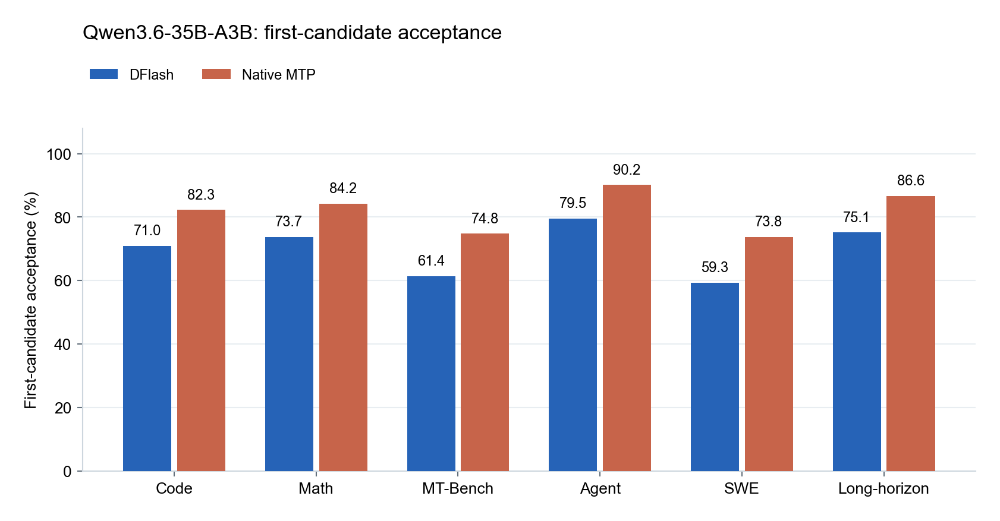
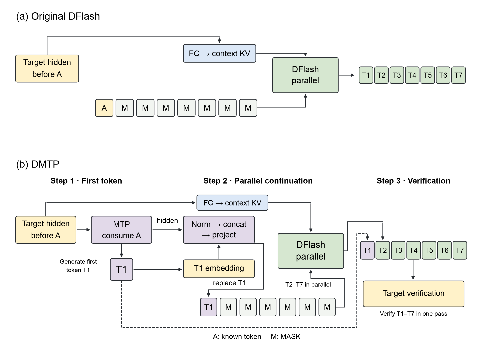
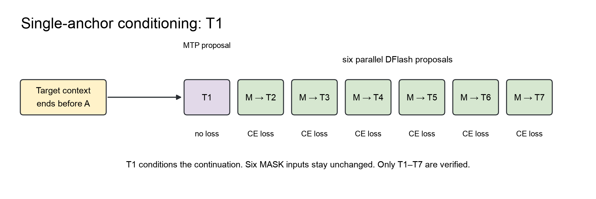
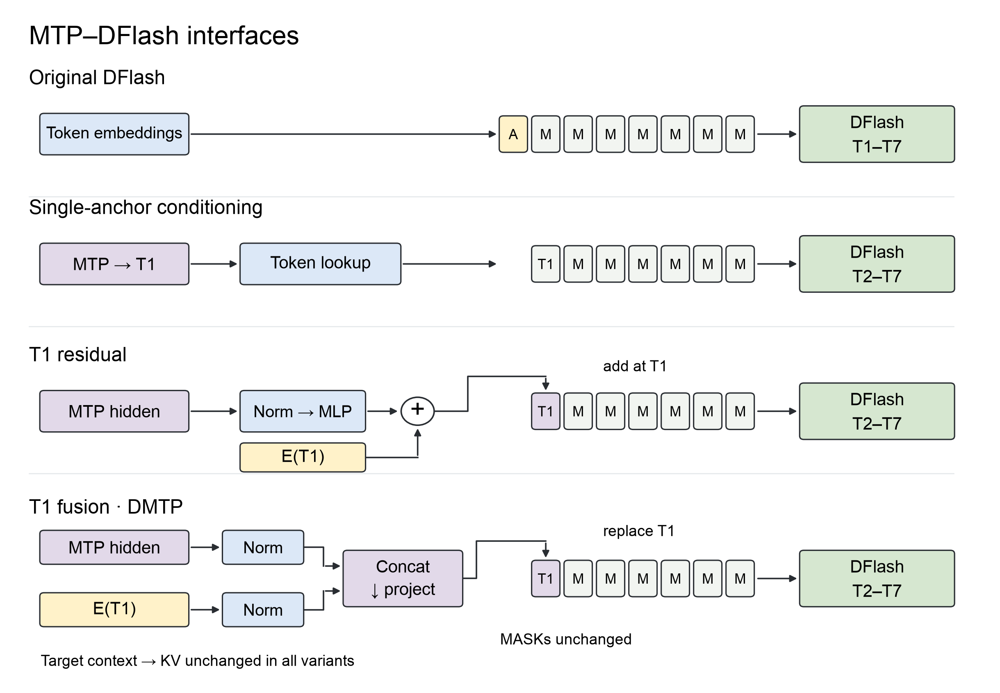
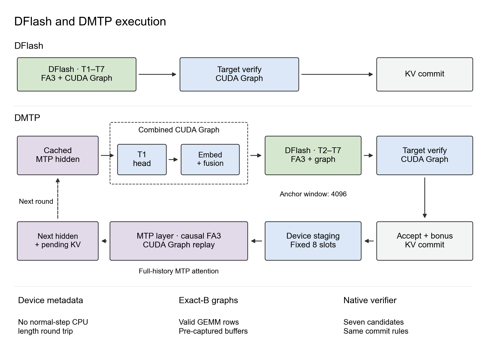
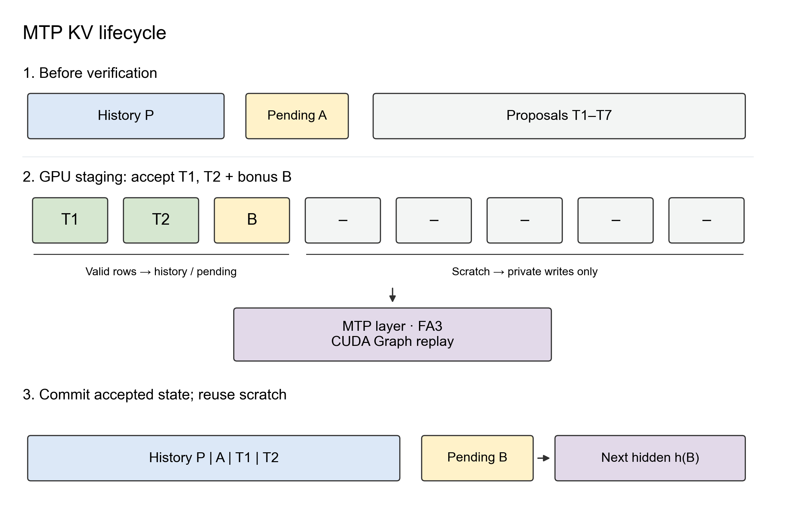
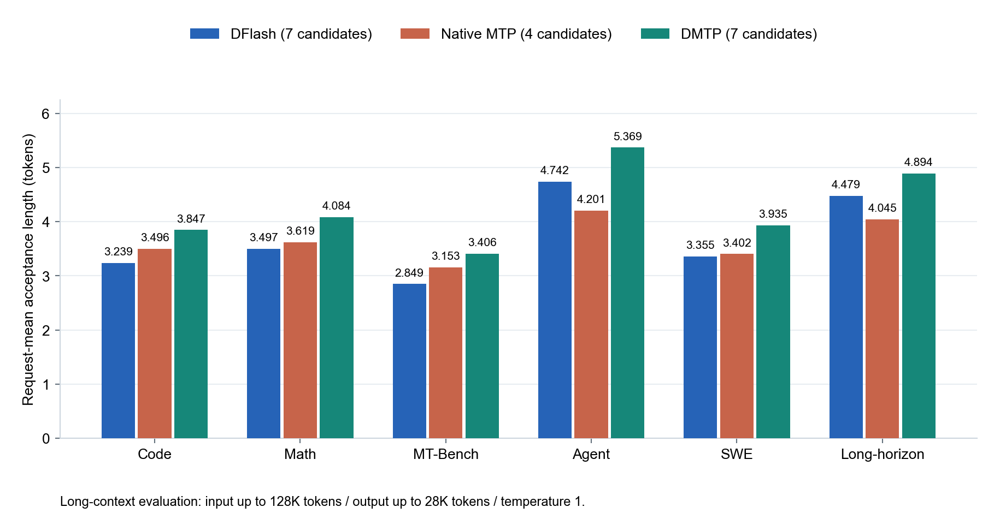
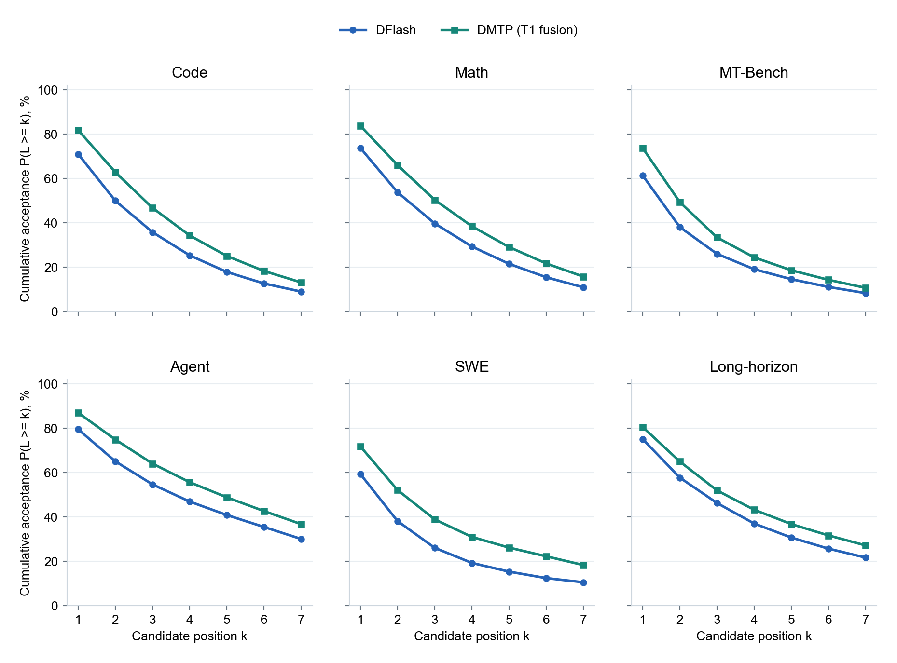
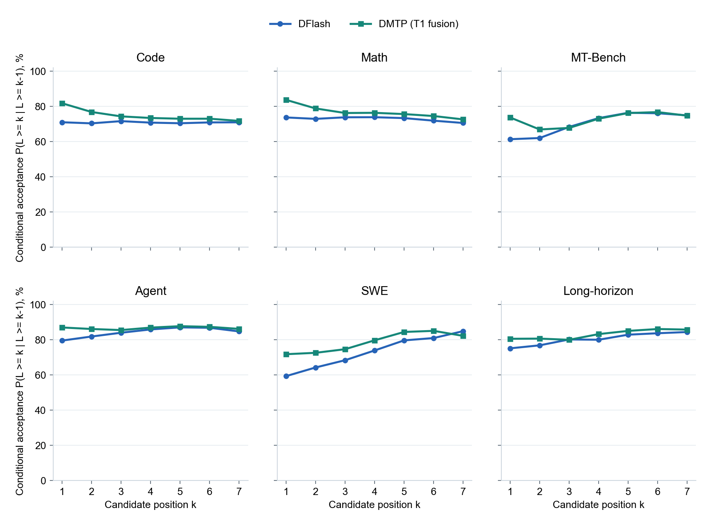
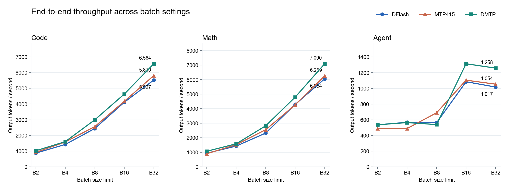

# DMTP：让预训练 MTP 为并行 Draft 开个好头

**Piggy Shen · 2026 年 10 月 · 技术博客**

投机解码已成为大模型推理基础设施的重要组成部分。[DFlash](https://z-lab.ai/projects/dflash/) 展示了并行预测多个候选的潜力，DeepSeek 也在生产服务中采用 [DSpark](https://arxiv.org/abs/2607.05147)，并报告了相对 MTP 的收益。然而，在 GLM、Qwen 等原生 MTP 训练充分的模型及部分对话场景中，DFlash 相比 MTP 并不总有显著优势。我们关注的是如何复用 MTP 的首 token 预测能力。

我们的评测以及与 [Domino](https://arxiv.org/abs/2605.29707) 作者 Jianuo Huang 的讨论，揭示了两者的互补性：原生 MTP 的首 token 接受率更高，在训练分布之外的场景下尤其明显；DFlash 则能并行生成更长的续写。这为结合预训练首位能力与并行预测提供了直接动机。

针对 DFlash 类模型在候选块内后续位置接受率逐渐衰减的问题，已有多种改进方案。**我们关注的是另一个问题：能不能先把第一个候选 token 的接受率提上去？** 验证按连续前缀接受：首位被拒绝，后面的候选就无法在本轮提交。DMTP 从预训练 MTP 的首位预测出发，再把预测它时的隐藏状态传给 DFlash，帮助后续并行续写。

我们提出 **DMTP**：由预训练 MTP 生成每轮起草的第一个候选 token（记为 **T1**），再由 DFlash 并行生成后六个候选（**T2～T7**）。本文选择 **MTP 式词元与隐藏状态融合**作为主方法，将预测首个候选时的 MTP 隐藏状态与该候选的词嵌入分别归一化、拼接投影，作为其输入表示。

> **核心思路：** 让 MTP 为生成开个好头，让 DFlash 并行完成续写。两者既共享候选 token，也通过预测表示建立联系，而不必替换各自的主干。

## 核心观察

- **原生 MTP 的首位优势值得复用。** 在相同目标模型和输入下，我们观察到 MTP 的首 token 接受率高于 DFlash。因此，我们让 MTP 生成首个候选，再由 DFlash 并行预测后六个候选。
- **通过隐藏状态，把 MTP 的预训练能力带给 DFlash。** 我们不只让 MTP 生成首个候选，还把预测它时的隐藏状态与候选的词嵌入融合。这样，DFlash 在续写时既能看到具体的候选，也能利用 MTP 在预训练中学到的特征，帮助后续 token 的并行预测。
- **组合后的收益体现在完整生成中，也能与已有优化结合。** 我们在六类任务上获得了 **9.25%～19.56%** 的接受长度提升；在 B32 的四类任务评测中，端到端吞吐提高了 **17.10%～23.75%**，均以 DFlash 为基线。DMTP 改进的是两者的协作方式，与 MTP、DFlash 各自的优化工作正交：更强的预测器、训练方法、候选选择策略和推理 kernel，都可以继续结合到这一框架中。

## 1. 首位接受率与并行 Draft

图 1 比较同一目标模型上的 **DFlash 与原生 MTP**。DFlash 使用混合任务数据训练，训练长度为 32K；MTP 使用同一目标模型自带的预训练权重。首 token 接受率指每轮第一个候选被目标模型接受的比例。

两组采用相同的Qwen3.6-35B-A3B target和输入集合，覆盖Code、Math、MT-Bench、Agent、SWE、Long-horizon六类负载。**DMTP组合只用MTP生成T1，后续六个候选由DFlash并行生成。**



*图 1：Qwen3.6-35B-A3B 在六类任务上的首 token 接受率，生成温度为 1。*

Code 上，DFlash 与 MTP 的首位接受率分别为 71.00% 和 82.32%。

**我们认为，大规模预训练是 MTP 首位优势的重要来源。** 原生 MTP 随 Target 一起训练，接触的数据远多于我们单独训练的 DFlash draft。这让我们更倾向于保留它已经学到的首位预测能力，而不是重新训练一个替代模块。

## 2. DMTP：MTP 生成首个候选，DFlash 并行续写

最直接的分工是：

```text
MTP：生成 T1
DFlash：以 T1 为条件，一次生成 T2～T7
Target：验证七个候选，提交接受前缀与修正/bonus
```



*图 2：原版 DFlash（上）与 DMTP（下）。DMTP 将预测首个候选时的 MTP 隐藏状态与该候选的词嵌入融合，再并行预测后六个候选。目标模型上下文到键/值缓存（KV）的原有路径保持不变；首个候选的词嵌入来自 token 查表。*

我们选择这个分工，主要考虑了三点。

**保留首位能力。** 我们冻结原生 MTP，保留其预训练的首位预测，只训练后续的并行 draft。

**缩短预测距离。** 给定 T1 后，T2 成为新 anchor 后的第一个未知 token，DFlash 以此为起点并行续写。

**传递预训练特征。** 除了 T1，我们还传入预测它时的 MTP hidden，让 DFlash 利用这些特征预测后续 token。

### 单步 MTP 预测

我们只用 MTP 生成 T1，以控制串行 draft 开销。更多 MTP 候选需要逐步前向与选词，而后六个候选可由 DFlash 一次并行生成。

## 3. MTP 表示的注入方式

我们采用 **MTP 式词元与隐藏状态融合**，并通过消融比较不同的表示注入方式。

下文将目标模型记为 Target、起草模型记为 Draft。设 \(A = x_a\) 是目标模型已经输出、但尚未处理的 token（pending token）；目标模型已有的上下文特征截止 \(x_{a-1}\)。MTP 读取上一位置的目标模型隐藏状态与 \(A\)，得到用于预测首个候选 \(T_1 = x_{a+1}\) 的表示，不需要目标模型处理 \(A\) 或 \(T_1\) 后的隐藏状态。

融合使用的就是**预测 T1 时的 MTP hidden**，不是消费 T1 之后的下一份 hidden：

$$
\widetilde{\mathbf e}_{T_1}=W_f\left[\operatorname{RMS}_e(\mathbf e_{T_1});\operatorname{RMS}_m(\mathbf h_{\mathrm{MTP}})\right].
$$

两路 2048 维特征独立使用可学习 RMSNorm，再经 4096→2048 线性投影。输入采用 `[T1,MASK×6]`，其中 MASK 表示待预测位置的掩码。只用融合结果替换首个候选的词嵌入；六个掩码的词嵌入与原预测头保持不变，目标模型上下文沿用原特征投影与键/值缓存（KV）路径，不向 DFlash 上下文拼入 MTP 的 KV。

### MTP 式融合的设计

我们借鉴原生 MTP 的归一化与拼接投影结构，融合参数单独训练。E(T1) 指定候选 token，MTP hidden 提供预测特征，六个 MASK 通过 attention 读取融合后的 T1。

改动集中在 T1 的输入位置，历史特征、Target context 路径、DFlash 主干和候选预算保持不变。

### 单 Anchor 条件输入

> **一个 Anchor，七个候选。** 以 MTP 提出的 T1 为唯一 anchor，DFlash 并行预测 T2～T7。T1 仍可能被拒绝，送去验证的七个候选是 T1～T7。

MTP 仍然消费 A，产生 T1 及预测它的 hidden；DFlash 只接收融合后的 T1 和六个 MASK。Target context 截止 A 之前，不需要额外执行 Target 前向。

**双 Anchor 指在 MASK 前同时保留原本的 anchor A 和 MTP 提出的 T1。** 输入为 `[A,T1,MASK×6]`，相比单 anchor 的 `[T1,MASK×6]`，额外提供 E(A)，让后续 MASK 通过 attention 更直接地读取原本 anchor 的词嵌入信息。A 已经输出，不属于本轮新增候选。

我们选择效果接近、改动更少的单 Anchor：将原版 anchor 换成 T1，保留单 anchor 加 MASK 的布局。MASK 的 embedding、并行预测与原输出头结构不变，便于从已有 DFlash 继续微调。



*图3a：七个输入槽位、七个候选。T1由MTP生成，T2～T7由DFlash生成。已知T1槽位不计算draft预测loss。*

### 消融设计

- **原始 DFlash。** 单锚点外部基线，输入为 `[A,MASK×7]`，由 DFlash 提出全部七个候选。
- **仅使用候选词元的单锚点。** `[T1,MASK×6]`，不额外注入 MTP 隐藏状态；仍使用原目标模型的隐藏状态上下文。
- **隐藏状态残差（首个候选位置）。** MTP 隐藏状态经低秩网络得到残差，只加到 T1 词嵌入，六个掩码输入保持不变。
- **MTP 式词元与隐藏状态融合（主方法）。** MTP 隐藏状态与 E(T1) 分别归一化、拼接投影，只替换 T1 词嵌入。

补充对照包括六个掩码位置的隐藏状态残差、目标模型与 MTP 上下文融合，以及仅使用 MTP 上下文。上下文融合将五路目标模型特征与逐位置 MTP 特征拼接，进行 6H→H 投影。上述表示接口对照均以 T1 为唯一 anchor。



*图3b：仅展示主表四种方式，依次为原始 DFlash、仅使用候选词元的单锚点、首个候选位置的隐藏状态残差，以及 MTP 式词元与隐藏状态融合。四者均保留原目标模型上下文路径，候选预算均为七个；后两种分别在首个候选位置采用加性残差与替换式融合。*

### 推理消融：Code 接受长度

我们在相同的 8 条代码任务输入上比较不同表示接口，固定模型、候选数量与生成设置。

| 方法 | 表示接口 | Code 接受长度 | 相对单锚点对照 |
| --- | --- | --- | --- |
| 原始 DFlash | 单锚点，七个候选 | 3.360 | -10.89% |
| 仅使用候选词元的单锚点 | 无额外 MTP 隐藏状态注入 | 3.770 | +0.00% |
| 隐藏状态残差（首个候选位置） | MTP 隐藏状态残差只加到首个候选输入 | 3.864 | +2.48% |
| MTP 式词元与隐藏状态融合（双锚点） | 保留原本 A 与融合后的 T1，输入 [A,T1,MASK×6] | 3.951 | +4.80% |
| **MTP 式词元与隐藏状态融合（主方法）** | **仅替换首个候选词元的输入表示** | 3.963 | +5.12% |

**双 Anchor 的接受长度为 3.951，与单 Anchor 主方法的 3.963 基本一致。** 因此采用单 Anchor，保留原版 DFlash 的单 anchor 加 MASK 结构，减少接口改动。

**加入 MTP hidden 后，接受长度从 3.770 提升至 3.963（+5.12%）。** 词元与隐藏状态融合在这组 Code 消融中表现最好，因此我们选择它作为主方法。

*接受长度取 8 条 Code 请求的均值，包含 Target 修正/bonus token。主表采用统一推理实现；补充表中的六位置残差采用独立实现，作为辅助对照。*

<details>
<summary>补充对照：其他表示接口</summary>

| 方法 | 表示接口 | Code 接受长度 | 相对单锚点对照 |
| --- | --- | --- | --- |
| 隐藏状态残差（六个掩码位置） | MTP 隐藏状态残差加到六个掩码输入 | 3.842 | +1.92% |
| 目标模型与 MTP 上下文融合 | 五路目标模型特征与 MTP 特征拼接投影 | 3.714 | -1.49% |
| 仅使用 MTP 上下文 | 由逐位置 MTP 特征提供上下文 | 3.565 | -5.43% |

</details>

### 与现有 Draft 方法的兼容性

我们保留 DFlash 主干、输出头与 Target context 接口。配置匹配时，可从已有 DFlash 权重继续微调，新增 T1 融合模块，使用 `[T1,MASK×6]` 监督后六个预测位置；Target 与 MTP 保持冻结。

这一接口与 MTP、DFlash 各自的优化正交，可以结合更强的预测器、训练方法、候选路径选择策略和推理算子。

### 为什么保留预训练 MTP

我们也尝试过将 MTP layer 直接用于 DFlash 式并行预测，但观察到首位表现受到影响，收敛收益也有限。这让我们选择先冻结预训练 MTP，把它的首位能力保留下来，再围绕 T1 训练并行续写。

## 4. DMTP 训练流程

我们使用 Qwen3.6-35B-A3B，训练长度为 32K，数据规模约 25 万条，大部分来自 Agent 和 Long-horizon 场景。MT-Bench 属于训练分布之外的评测，用于观察模型的跨场景泛化表现。

DFlash 与 DMTP 使用相同的训练数据、训练超参数和训练预算。DMTP 在此基础上接入原生 MTP 的首 token 预测及其隐藏状态，并训练首个候选位置的融合模块。

训练分为三步：

1. **提取冻结特征。** 目标模型处理训练序列；在每个候选块边界，MTP 读取当前已输出 token（A）与上一位置的目标模型隐藏状态，得到预测首个候选的表示。DFlash 上下文只使用 A 之前的目标模型特征。
2. **构造起草输入。** 使用 `[T1,MASK×6]`，其中首个候选取自训练数据。其词嵌入与预测它时的 MTP 隐藏状态分别归一化、拼接投影，替换该位置的输入，六个掩码不变。
3. **优化后续预测。** DFlash 沿用原位置衰减交叉熵损失，学习后六个候选。目标模型与 MTP 冻结，只更新 DFlash 与融合模块；首个候选作为已知输入，不计算起草预测损失。

训练时我们使用<mark>训练数据中的首个候选 token</mark>，推理时换成 MTP 实际生成的候选。两边使用的隐藏状态保持相同的时序：都取预测首个候选时的 MTP 表示，而不是读取该候选之后产生的隐藏状态。

## 5. 推理流程：先 MTP，再 DFlash

每一轮生成都按图 2 的顺序执行：

1. **MTP 生成首个候选。** 读取已有的目标模型隐藏状态，处理当前已输出、但目标模型尚未处理的 token（A），保留首个候选及预测它时的 MTP 隐藏状态。
2. **DFlash 并行预测后六个候选。** 构造 `[T1,MASK×6]`，融合首个候选的词嵌入与预测它的 MTP 隐藏状态，只替换该候选的输入，再运行一次并行 DFlash 前向。
3. **目标模型统一验证。** 一起验证七个候选，提交接受前缀及修正或 bonus token，再进入下一轮。bonus 指所有起草候选都被接受后，由目标模型额外生成的一个 token。

**我们在本文实验中统一使用 target-only 验证。** 根据 Target 的采样结果逐 token 检验候选，接受连续匹配的前缀。Rejection sampling 和 block verify 暂未接入，我们会在后续比较它们对接受长度和吞吐的影响。

运行时分别维护 MTP 与 DFlash 状态，只提交接受的历史，回退被拒绝候选产生的临时状态。

新增计算包括一次 MTP 前向、生成首个候选的词表输出层（LM head），以及两路归一化和一次融合投影。目标模型上下文路径保持不变，DFlash 使用首个候选与六个掩码，共七个输入槽位。

接下来，我们重点优化状态更新、执行调度和 CUDA Graph 覆盖，减少 MTP 与 DFlash 之间的衔接开销。

## 6. 推理实现与系统优化

我们保留七个候选的预算和 Target 原有的验证规则，重点优化 MTP 状态推进与 T1 准备阶段。

### 6.1 一轮执行：预测与状态推进分开



*虚线框表示 T1 head、embedding 与融合的组合 CUDA Graph，虚线箭头连接相邻两轮。*

Prefill 初始化三侧状态。稳态轮次开始时，我们从缓存的 MTP hidden 选出 T1，再完成 embedding、融合和 DFlash 前向。

Target 验证后，我们用接受前缀、修正/bonus token 及对应的 Target hidden 推进 MTP 状态，缓存下一轮的预测表示。下一轮即可直接从 T1 head 开始。

### 6.2 Attention 适配：同一 backend，不同可见范围

我们继续使用 DFlash 已有的 FlashAttention-3 和 CUDA Graph，并把新增 MTP 路径也接到 FlashAttention-3 上。不过，两侧的可见范围不同：MTP 对完整历史执行因果注意力；DFlash 则读取相对锚点最近的 4096 个历史位置，以及按训练约定可见的七槽输入块。

DFlash 路径通过临时页表表达历史窗口与七槽块，不搬动历史键/值缓存，不改变旋转位置编码（RoPE）的位置，也不将相对锚点的窗口替换成相对每个查询位置的窗口。MTP 路径保留原 FlashAttention-3 算子，在设备端准备固定八槽输入的元数据，避免正常步骤依赖 CPU 长度回传。

### 6.3 键/值缓存生命周期：历史、待处理位置与临时空间



*图中以接受 T1、T2 后产生 bonus B 为例，展示 MTP 状态的推进与提交。*

我们为 MTP 单独维护键/值缓存，并额外保留待处理位置（图中的 pending 槽位）。原因是两侧的推进时序不同：MTP 可能已经处理了当前锚点，而目标模型还没有。验证结束后，我们按接受结果分别更新两侧边界，只提交应该进入历史的状态。

为了让不同接受长度复用同一套图，我们给每个请求预留八个 MTP 状态推进槽位。有效行进入历史或下一轮待处理位置，多余行写入私有临时空间（图中的 scratch）。提交哪些状态、取哪个隐藏状态作为下一轮预测表示，都由有效行数决定；临时空间中的输出不参与后续预测。

### 6.4 图执行：优化新增阶段的准备与提交

我们按有效请求数预先捕获 CUDA Graph，让融合矩阵乘法只计算实际需要的行。解码时在设备端准备数据并更新固定缓冲，再回放执行图。

随后，我们把首个候选的词表输出、候选写入、目标模型词嵌入和融合算子合进一次图提交，减少主机端调度。这里只合并提交，不改变算子的依赖顺序、精度、最大概率选词规则或张量并行通信。

| 部分 | 适配或优化 | 减少的成本 |
| --- | --- | --- |
| MTP 状态推进 | 设备端固定八槽、私有键/值缓存与执行图回放 | 正常步骤的 CPU 长度回传、数据打包展开与重复调度 |
| DFlash 注意力 | FlashAttention-3 临时页表表达锚点窗口与块可见性 | 避免为窗口重建或搬移历史键/值缓存 |
| 首个候选准备 | 词表输出→候选写入→词嵌入→融合组合图 | 多次主机端执行图提交及阶段衔接 |
| 接受结果提交 | 有效行决定历史、待处理位置和临时空间的写入及隐藏状态选择 | 动态长度的布局转换 |

### 6.5 优化后的开销构成

经过设备端状态准备、固定布局和组合图优化，主要新增计算是**一层 MTP 解码器和选出首个候选的词表输出层**。MTP 仍包含全历史因果注意力、投影、归一化、前馈网络和张量并行通信，其成本随上下文长度变化。

**词表输出层是后续的优化重点。** 即使只生成首个候选，标准输出层仍需读取大词表权重，计算整个词表的预测分数。

我们计划借鉴 [EAGLE-4 的高效词表输出层](https://github.com/eagle-hq/EAGLE-4/blob/main/docs/architecture.md)，先用低秩输出层筛选候选，再用原始输出层精确重算；也会尝试起草侧输出层量化，降低权重读取与投影成本。目标模型验证路径保持不变，优化效果将结合接受长度和吞吐评估。

#### 单 Anchor 的实测开销

我们在同一组四卡上，对比单 anchor T1 融合模型（step 1000）与原生 DFlash（step 3634）。Code、SWE 各取 8 条相同输入，实际 batch 为 8，开启 CUDA Graph，固定生成 512 tokens，忽略 EOS，排除前 16 轮热身后统计。

| 阶段（ms／轮） | Code：DFlash | Code：单 anchor | SWE：DFlash | SWE：单 anchor |
| --- | ---: | ---: | ---: | ---: |
| DFlash 图重放 | 0.386 | 0.388 | 0.442 | 0.427 |
| 新增 MTP 图重放 | — | 0.214 | — | 0.283 |
| 新增 T1 选词、embedding 与融合 | — | 0.290 | — | 0.274 |
| **整轮（含准备与验证）** | **8.915** | **9.318** | **9.645** | **10.195** |

DFlash 图重放耗时基本不变，新增阶段主要是 MTP 和 T1 准备。整轮时间在 Code 上增加 **0.403 ms**，在 SWE 上增加 **0.550 ms**。

## 7. 主方法的六类生成评测

我们的评测主要侧重**长上下文 Agent 场景**，同时覆盖 Code、Math 和 MT-Bench，并与 DFlash、原生 MTP 比较。按输入输出形态，前三类（Code、Math、MT-Bench）主要是**短输入、长输出**，后三类（Agent、SWE、Long-horizon）主要是**长输入、短输出**。其中，MT-Bench 用于训练分布之外的评测。

输入长度上限为 **128K**，输出长度上限为 **28K**；各方法使用相同输入，生成温度为 1。

| 负载 | DFlash接受长度 | 原生MTP接受长度* | DMTP接受长度 | DMTP相对DFlash |
| --- | --- | --- | --- | --- |
| Code | 3.239 | 3.496 | 3.847 | +18.78% |
| Math | 3.497 | 3.619 | 4.084 | +16.78% |
| MT-Bench | 2.849 | 3.153 | 3.406 | +19.56% |
| Agent | 4.742 | 4.201 | 5.369 | +13.22% |
| SWE | 3.355 | 3.402 | 3.935 | +17.29% |
| Long-horizon | 4.479 | 4.045 | 4.894 | +9.25% |

*原生 MTP 提出 4 个候选，DFlash 与 DMTP 均提出 7 个候选。*

*平均接受长度包含 Target 的修正或 bonus token。*



*图 5：DMTP 在六类任务上的平均接受长度相对 DFlash 提高 9.25%～19.56%。*

### 逐位置接受率

图 6 展示 T1～T7 的累计接受率。



*图 6：逐位置累计接受率 P(L≥k)，即每轮验证中前 k 个 draft 候选全部接受的比例，不包含修正/bonus。评测设置同上。*

DMTP 在六类任务的 T1～T7 位置均获得了更高的累计接受率，表明首位增强与后续并行预测可以共同提升整个候选块的接受表现。

<details>
<summary>条件接受率：已经接受前k−1个候选后，第k个继续接受的比例</summary>



| 数据集 / 模型 | 验证轮数 | T1 | T2 | T3 | T4 | T5 | T6 | T7 |
| --- | --- | --- | --- | --- | --- | --- | --- | --- |
| Code / DFlash | 523201 | 71.00% | 70.38% | 71.64% | 70.79% | 70.43% | 70.91% | 70.97% |
| Code / DMTP（T1融合） | 434780 | 81.81% | 76.83% | 74.34% | 73.43% | 73.00% | 73.02% | 71.76% |
| Math / DFlash | 473538 | 73.73% | 72.93% | 73.82% | 73.87% | 73.36% | 71.90% | 70.59% |
| Math / DMTP（T1融合） | 404689 | 83.72% | 78.84% | 76.25% | 76.36% | 75.64% | 74.54% | 72.62% |
| MT-Bench / DFlash | 54479 | 61.36% | 62.04% | 68.34% | 73.36% | 76.38% | 76.11% | 74.92% |
| MT-Bench / DMTP（T1融合） | 41259 | 73.72% | 66.90% | 67.78% | 73.03% | 76.24% | 76.77% | 74.74% |
| Agent / DFlash | 22213 | 79.53% | 81.84% | 84.00% | 85.87% | 87.05% | 86.81% | 84.74% |
| Agent / DMTP（T1融合） | 17371 | 86.98% | 86.12% | 85.51% | 86.91% | 87.72% | 87.34% | 86.18% |
| SWE / DFlash | 4795 | 59.33% | 64.25% | 68.38% | 73.92% | 79.65% | 80.98% | 84.90% |
| SWE / DMTP（T1融合） | 3836 | 71.79% | 72.59% | 74.64% | 79.69% | 84.44% | 85.06% | 82.20% |
| Long-horizon / DFlash | 2919 | 75.13% | 76.84% | 80.18% | 80.01% | 82.89% | 83.71% | 84.40% |
| Long-horizon / DMTP（T1融合） | 2798 | 80.56% | 80.66% | 79.98% | 83.22% | 85.04% | 86.10% | 85.78% |

</details>

### 接受长度与端到端吞吐

下表使用 B32 参考评测：DFlash 和 DMTP 在同一组四张 H200 GPU 上依次运行，使用相同 SGLang 版本与 TP4。每类任务取 64 条相同输入，温度为 1，输出上限为 28K，保留自然 EOS；服务上下文上限为 262144 tokens。图 7 进一步展示 B2～B32 的吞吐结果。

评测采用动态批处理：Bn 为 batch 上限，实际 batch 随请求完成而变化。不同任务类别与 batch 设置之间清空缓存，同组请求保留正常的 radix cache 复用。下表与图 7 为端到端评测，图 5、图 6 则侧重候选接受表现。

| 负载 | DFlash per-request | DMTP per-request | DFlash per-verify | DMTP per-verify |
| --- | --- | --- | --- | --- |
| Code | 3.227 | 3.814 | 3.198 | 3.795 |
| Math | 3.461 | 4.100 | 3.429 | 4.056 |
| MT-Bench | 2.890 | 3.459 | 2.706 | 3.250 |
| Agent | 4.795 | 5.254 | 4.249 | 4.709 |
| SWE | 3.407 | 3.881 | 2.794 | 3.173 |
| Long-horizon | 4.356 | 5.022 | 3.641 | 4.656 |

表中的**请求级平均（per-request）**先计算每条请求的平均接受长度，再对请求取平均；**验证轮次平均（per-verify）**按所有验证轮次计算平均推进 token 数：`1 + Σ(k × histogram[k]) / Σhistogram`，其中 `histogram[k]` 表示接受了 k 个起草候选的验证轮数，额外的 1 为目标模型的修正或 bonus token。



*图 7：DFlash、原生 MTP 与 DMTP 在 Code、Math、Agent 上的四卡张量并行（TP4）端到端吞吐，单位 tok/s，三个子图采用独立纵轴。图中 MTP415 指四步 MTP、四个候选、五个验证槽位。Bn 表示 batch 上限为 n；B2/B4/B8 各取前 8 条，B16/B32 各取前 64 条，保留自然 EOS 与 28K 上限。DFlash/DMTP 的 B32 沿用同卡顺序参考评测，其他点为固定两组 TP4 并行扫描；原生 MTP 为独立扫描。*

我们加入公开 Qwen3.6-35B-A3B 的原生 MTP 吞吐作为参考：四步、top-k=1、五个验证槽位，共提出四个候选，关闭 overlap。DFlash/DMTP 使用内部 Target 权重、七个候选，开启 overlap。

**为什么选择四步 MTP？** 在这组配置下，三步 MTP（MTP314）的起草开销与五层 DFlash 接近。DMTP 在 DFlash 之外增加一次 MTP 预测，因此我们选择四步 MTP（MTP415）作为起草开销近似匹配的对照。四步也是 Qwen 推理中常用的 MTP 基线设置。

**在 B32 参考评测中，DMTP 在图示三类任务上获得 17.10%～23.75% 的端到端吞吐提升。** Code 从 5526.78 提升至 6564.08 tok/s（+18.77%），Math 从 6054.42 提升至 7089.92 tok/s（+17.10%），与两类任务约 18% 的 per-verify 接受长度提升相呼应。Agent 从 1016.94 提升至 1258.44 tok/s（+23.75%）。

我们用总输出 token 数除以整组请求的完成时间计算端到端吞吐，覆盖排队、输入预填充和解码；输出遇到结束符（EOS）时正常停止。

## 8. 开源复现与评测

为便于复现，我们使用**开源 Qwen3.6-27B 权重与 OpenPerfectBlend 数据集**，训练 DFlash、DFlash2 及各自对应的 DMTP 版本。四组采用相同的数据与训练预算，目标模型和原生 MTP 保持冻结。起草模型统一使用五层结构，动态序列长度最长为 2K，全局批量为 128，在八张 GPU 上以 BF16 训练三个 epoch，即完整遍历训练数据三次，约 31K 步。

DFlash 沿用位置衰减交叉熵，DFlash2 结合块内信息交互、路径选择与自适应损失。在两组基线之上，我们分别加入首个候选位置的 MTP 表示融合，训练对应的 DMTP 版本，保持每轮七个候选的预算不变。

### 接受长度评测

评测使用四卡张量并行，批量上限为 32，温度为 0，每轮最多生成 1,024 个 token，遇结束符正常停止。我们统一使用目标模型的聊天模板，设置 `enable_thinking=False`，并沿用前文的 target-only 验证方式。

OpenPerfectBlend 侧重数学与代码，因此我们除数学、代码任务外，也使用 Alpaca 和 MT-Bench 观察聊天场景下的表现。每个数据集取前 80 条；MT-Bench 保留完整双轮会话，第二轮使用各模型自身的第一轮回答。

<table>
<colgroup><col style="width:22%"><col style="width:22%"><col style="width:22%"><col style="width:34%"></colgroup>
<thead><tr><th class="acceptance-dataset" scope="col">数据集</th><th class="acceptance-model" scope="col">原生 MTP415</th><th class="acceptance-model" scope="col">DFlash</th><th class="acceptance-model" scope="col">DMTP(DFLASH)</th></tr></thead>
<tbody><tr><th scope="row">GSM8K</th><td class="model-start mtp415">4.373</td><td class="model-start dflash">4.318</td><td class="model-start dmtp"><strong>5.074</strong> <strong class="acceptance-gain">(+17.50%)</strong></td></tr>
<tr><th scope="row">HumanEval</th><td class="model-start mtp415">4.698</td><td class="model-start dflash">6.424</td><td class="model-start dmtp"><strong>6.795</strong> <strong class="acceptance-gain">(+5.78%)</strong></td></tr>
<tr><th scope="row">MATH500</th><td class="model-start mtp415">4.377</td><td class="model-start dflash">4.258</td><td class="model-start dmtp"><strong>4.968</strong> <strong class="acceptance-gain">(+16.67%)</strong></td></tr>
<tr><th scope="row">Alpaca</th><td class="model-start mtp415"><strong>3.529</strong></td><td class="model-start dflash">2.763</td><td class="model-start dmtp">3.358 <strong class="acceptance-gain">(+21.55%)</strong></td></tr>
<tr><th scope="row">MT-Bench</th><td class="model-start mtp415">3.599</td><td class="model-start dflash">3.209</td><td class="model-start dmtp"><strong>3.760</strong> <strong class="acceptance-gain">(+17.15%)</strong></td></tr></tbody>
</table>


表中报告**请求级平均接受长度（Per-request）**，包含目标模型的修正或 bonus token；MT-Bench 的每轮生成分别计入。<strong class="acceptance-comparison">DMTP 相对 DFlash 的提升</strong>以红色括号标出。原生 MTP415 每轮提出四个候选，DFlash 与 DMTP 均为七个。

## 9. 后续方向

**DMTP 的一个局限，是它依赖原生 MTP 的首位预测能力。** 如果 MTP 在某些场景下训练不够充分，它的首 token 接受率可能低于经过任务数据微调的 DFlash。这时，直接把首位交给 MTP 未必是更好的选择。我们还需要进一步探索这种差异，以及如何通过训练和两者的协作改善这些场景。

我们还想继续探索几个方向：

- **自适应多步 MTP。** 探索自适应选择 MTP 生成步数，再由 DFlash 并行续写。
- **更强的验证方式。** 在当前 target-only 验证基础上，探索 rejection sampling 与 block verify，评测其对接受长度、采样一致性及端到端吞吐的影响。
- **统一MTP与DFlash的训练范式。** 能否把两者放到同一个框架下，进一步理解首token接受率和后续位置衰减差异背后的原因？
- **联合训练。** MTP不一定要冻结，也可以和DFlash一起训练，研究如何在保留首位优势的同时提升整个block的预测能力。
- **多层MTP做block预测。** 能否让多层MTP学习block预测，将已有的预训练能力与并行draft结合起来？
- **更大的模型。** 将 DMTP 扩展到更大规模的 Target，探索不同的 MTP–DFlash 组合，检验其在更大模型上的泛化能力与加速潜力。

DMTP 仍是一次初步探索。我们将继续分享更多模型与场景下的实验结果，相关论文与开源代码也将于近期公开。欢迎大家复现实验，分享不同模型、数据和任务上的发现，也欢迎参与训练方法与推理实现的改进，一起把这条路线探索得更清楚。

## 参考资料

1. [DFlash: Block Diffusion for Flash Speculative Decoding](https://z-lab.ai/projects/dflash/)
2. [DSpark: Confidence-Scheduled Speculative Decoding with Semi-Autoregressive Generation](https://arxiv.org/abs/2607.05147)
3. [SpecForge v0.3.0](https://www.lmsys.org/blog/2026-08-04-specforge-v0-3)
4. [Domino: Decoupling Causal Modeling from Autoregressive Drafting in Speculative Decoding](https://arxiv.org/abs/2605.29707) · [官方代码](https://github.com/jianuo-huang/Domino)

## 致谢

感谢 **Qwen Team、Domino Team、Qwen Application Team 和 SpecForge Team** 的支持与交流。这项工作是在我于 **Qwen Infra 团队实习期间**完成的。

**Qwen Team**：Yuhao Shen、Di Liu、Yucheng Li、Hao Yu、Yang Xu、Xi Lin、Yi Zhang。

**Domino Team**：Jianuo Huang。

**Qwen Application Team**：Tianyu Liu、Jun Zhang。

**SpecForge Team**：Jiaping Wang。

## 引用

如果这项工作对你有帮助，欢迎引用这篇技术博客：

```bibtex
@misc{shen2026dmtp,
  author = {Shen, Yuhao},
  title  = {{DMTP}: A Better First Token for Block Drafting via MTP},
  year   = {2026},
  note   = {Technical blog}
}
```
